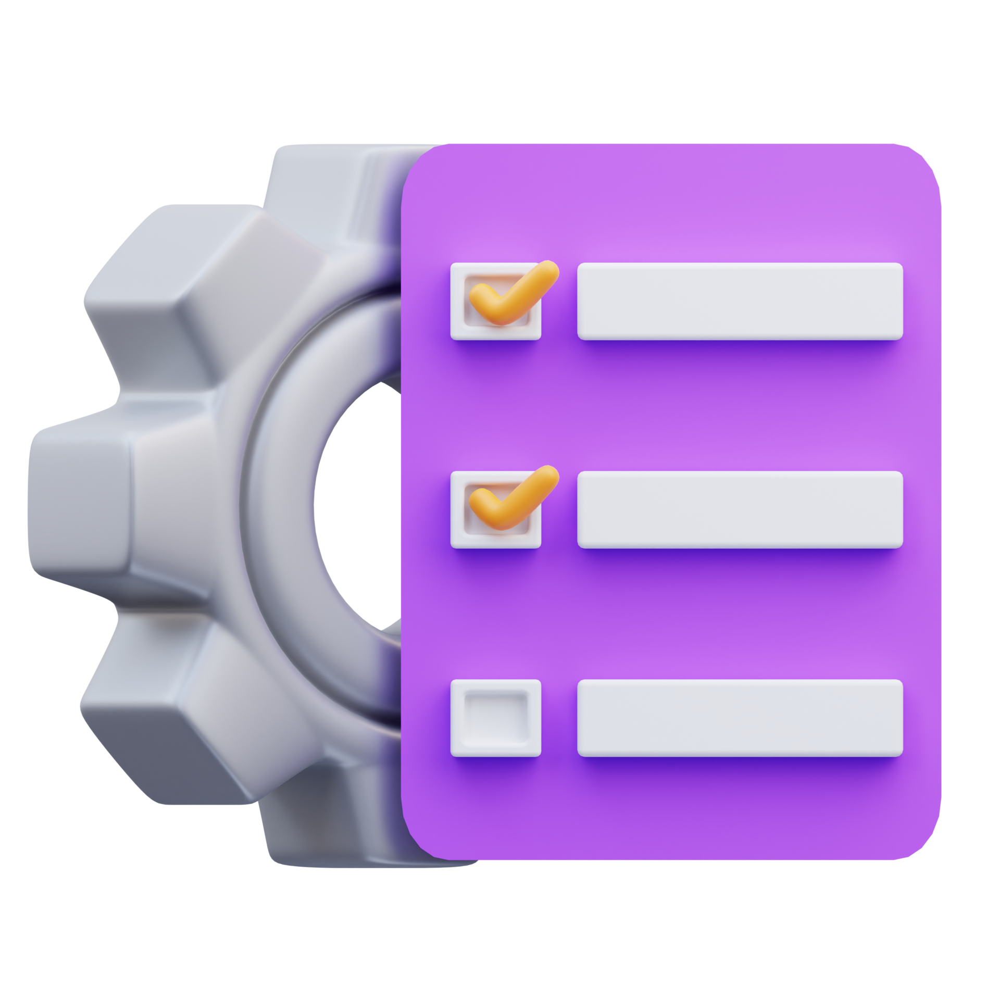

# tsky



Tsky is a Windows desktop task launcher built with .NET WPF.
It reads a `tasks.json` configuration file at startup and creates one button per configured task.

## Prerequisites

- Windows
- .NET 8 SDK or newer

## Run the App

1. Open a terminal in the project folder.
2. Run:

```powershell
dotnet run
```

## Configuration File

The app loads `tasks.json` from the application output folder (copied automatically during build).

### Task Schema

Each task supports:

- `name`: Display text for the button
- `description`: Optional body text shown below the task name on the card
- `group`: Logical grouping label used for organization in the UI
- `commandLine`: Command to run
- `runner`: Execution mode (`exe`, `cmd`, `powershell`)
- `waitForExit`: Optional; default `true`. Set `false` for fire-and-forget tasks (continue immediately after process start)
- `env`: Optional environment variable overrides for the launched process
- `workingDirectory`: Optional working folder for the launched process
- `inputs`: Optional input port defaults for this task
- `inputBindings`: Optional input port bindings from prior task outputs or shared ports
- `outputs`: Optional output ports published after successful task execution

If `runner` is omitted, the default is `exe`.

If `waitForExit` is omitted, the default is `true`.

Tasks can be stored either as a legacy flat `tasks` array or the grouped `groups` format.

### Ritual Chains

Rituals let you run themed sequences of tasks from the `Rituals` menu.

- `rituals`: Optional top-level array of ritual definitions.
- `rituals[].name`: Ritual display name.
- `rituals[].description`: Optional description shown in tooltip.
- `rituals[].steps`: Ordered list of steps.
- `rituals[].steps[].taskName`: Task name to execute.
- `rituals[].steps[].group`: Optional group filter when task names are reused.
- `rituals[].steps[].delayMs`: Optional delay before step execution.
- `rituals[].steps[].continueOnError`: Optional; continue ritual even if step fails or task is missing.

Ritual steps honor each task's `waitForExit` flag, so GUI launchers can be fire-and-forget while other steps remain blocking.

```json
{
  "groups": [
    {
      "name": "Utilities",
      "tasks": [
        {
          "name": "Open Browser",
          "group": "Utilities",
          "runner": "exe",
          "commandLine": "\"C:\\Program Files (x86)\\Microsoft\\Edge\\Application\\msedge.exe\"",
          "waitForExit": false
        },
        {
          "name": "Open Notepad",
          "group": "Utilities",
          "runner": "exe",
          "commandLine": "notepad.exe",
          "waitForExit": false
        }
      ]
    }
  ],
  "rituals": [
    {
      "name": "Start Coding",
      "description": "Warm up my coding workspace.",
      "steps": [
        { "taskName": "Open Browser", "group": "Utilities" },
        { "taskName": "Open Notepad", "group": "Utilities", "delayMs": 300 }
      ]
    }
  ]
}
```

### Compact Dataflow Chain Example

This example shows a same-group chain where each task can consume values from previous task outputs.
Use the task card menu action `Run Chain (Same Group)` starting from `Resolve Context`.

```json
{
  "groups": [
    {
      "name": "BuildFlow",
      "tasks": [
        {
          "name": "Resolve Context",
          "group": "BuildFlow",
          "runner": "cmd",
          "inputs": {
            "repoRoot": "C:\\_dev_env_\\code\\tsky",
            "buildConfig": "Release"
          },
          "commandLine": "echo preparing ${input:repoRoot}",
          "outputs": {
            "repoPath": "${input:repoRoot}",
            "config": "${input:buildConfig}"
          }
        },
        {
          "name": "Compile",
          "group": "BuildFlow",
          "runner": "cmd",
          "inputBindings": {
            "repo": "Resolve Context.repoPath",
            "cfg": "Resolve Context.config"
          },
          "workingDirectory": "${input:repo}",
          "commandLine": "dotnet build -c ${input:cfg}",
          "outputs": {
            "artifactDir": "${input:repo}\\bin\\${input:cfg}"
          }
        },
        {
          "name": "Report",
          "group": "BuildFlow",
          "runner": "powershell",
          "inputBindings": {
            "outDir": "Compile.artifactDir"
          },
          "commandLine": "Write-Host \"Artifacts at ${input:outDir}\""
        }
      ]
    }
  ]
}
```

Supported binding/reference forms:

- `TaskName.outputName`
- `output:TaskName.outputName`
- `port:sharedName`
- `${input:name}` / `${port:name}` / `${output:TaskName.outputName}` placeholders

### Example

```json
{
  "groups": [
    {
      "name": "Maintenance",
      "tasks": [
        {
          "name": "Clean Logs",
          "group": "Maintenance",
          "description": "Deletes old log files and keeps recent history.",
          "commandLine": "C:\\_dev_env_\\bin\\cleanlogs.bat",
          "runner": "cmd"
        }
      ]
    },
    {
      "name": "Utilities",
      "tasks": [
        {
          "name": "Open Notepad",
          "group": "Utilities",
          "description": "Quick scratch pad for notes.",
          "commandLine": "notepad.exe",
          "runner": "exe"
        },
        {
          "name": "List Log Files",
          "group": "Utilities",
          "commandLine": "Get-ChildItem C:\\_dev_env_\\logs",
          "runner": "powershell"
        }
      ]
    }
  ]
}
```

## Runner Modes

### exe

Runs the command directly with no shell wrapper.

Use this for:

- `.exe` programs
- Commands available on PATH

For GUI launchers (browser, editor, etc.) that should not block downstream tasks, set `waitForExit` to `false`.

Tips:

- If the executable path contains spaces, quote it inside `commandLine`.
- You can include arguments after the executable.

Example:

```json
{
  "name": "Tool With Args",
  "commandLine": "\"C:\\Program Files\\MyTool\\tool.exe\" --input file.txt",
  "runner": "exe",
  "waitForExit": false
}
```

## Working Directory (`workingDirectory`)

Use `workingDirectory` when a task must run in a specific folder.

- Absolute and relative paths are supported.
- `%VAR%` placeholders are expanded (for example `%USERPROFILE%\\Downloads`).
- If the directory does not exist, task execution is rejected and logged.

Example:

```json
{
  "name": "Run Maven Build",
  "commandLine": "mvn -v",
  "runner": "exe",
  "workingDirectory": "C:\\_dev_env_\\code\\my-project"
}
```

### cmd

Runs with:

- `cmd.exe /c "<commandLine>"`

Use this for:

- `.bat` and `.cmd` scripts
- Windows command shell syntax

### powershell

Runs with:

- `powershell.exe -NoProfile -ExecutionPolicy Bypass -Command "<commandLine>"`

Use this for:

- PowerShell commands and scripts

## Environment Variables (`env`)

Use `env` to set or override variables for the spawned process only.

- Keys are variable names, for example `PATH`, `JAVA_HOME`, `MY_SETTING`.
- Values support `%VAR%` expansion using the current process environment and already-set variables.

Example:

```json
{
  "name": "Run Java App",
  "commandLine": "java -version",
  "runner": "exe",
  "env": {
    "JAVA_HOME": "C:\\_dev_env_\\Java\\jdk-21.0.6+7",
    "PATH": "%JAVA_HOME%\\bin;%PATH%"
  }
}
```

## Using the UI

1. Launch the app.
2. Click any task button to run it.
3. Each click creates a new output tab.
4. The tab shows:
   - Start info
   - Exit code
   - Standard output (stdout)
   - Error output (stderr)
5. Close a tab with the `x` button in its header.

## Copying Output

Output text areas support normal text selection and copy.

- Keyboard: `Ctrl+C`
- Right-click menu: `Copy` and `Select All`

## Empty Configuration Behavior

If there are no tasks in `tasks.json`, the window shows a helpful message instead of buttons.

## Troubleshooting

- No buttons appear:
  - Confirm `tasks.json` contains at least one task.
- Task fails immediately:
  - Check the selected `runner` value.
  - Verify file paths and quoting.
  - Review tab output for stderr and exit code.
- A batch file does not run:
  - Set `runner` to `cmd`.
- A direct executable does not run:
  - Set `runner` to `exe` and verify the executable path.

## GitHub Releases

This repository includes a GitHub Actions workflow at `.github/workflows/release.yml`.

The workflow is triggered by version tags that start with `v` (for example `v1.0.0`).
It builds release artifacts for Windows runtimes, packages them as zip files, and publishes them to a GitHub Release.

Published assets are framework-dependent single-file builds to keep download size smaller.
Target machines need the .NET 8 Desktop Runtime installed.

### Will GitHub Actions incur costs?

Potentially, yes.

- GitHub Actions minutes and artifact/storage usage can count against your plan limits.
- Public repositories often get generous or unlimited included minutes on GitHub-hosted runners.
- Private repositories have plan-based included minutes and can incur charges when limits are exceeded.

To check exact limits and pricing for your account/org:

- Open GitHub Settings -> Billing and plans
- Review Actions usage and included minutes/storage for your plan

### How to run a release

1. Commit and push your latest code to your main branch.
2. Create a semantic version tag prefixed with `v`.

```powershell
git tag v1.0.0
git push origin v1.0.0
```

3. Go to GitHub -> Actions and open the `release` workflow run.
4. After completion, open GitHub -> Releases and find tag `v1.0.0`.
5. Download the attached zip assets for the target runtime(s).

### Versioning notes

- The workflow derives application version metadata from the pushed tag.
- Use tags like `v1.2.3` (or prerelease tags like `v1.2.3-beta.1`).

