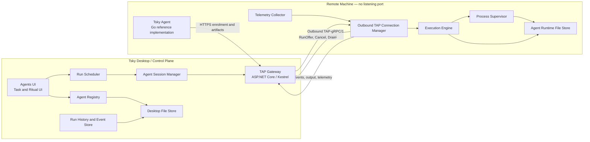
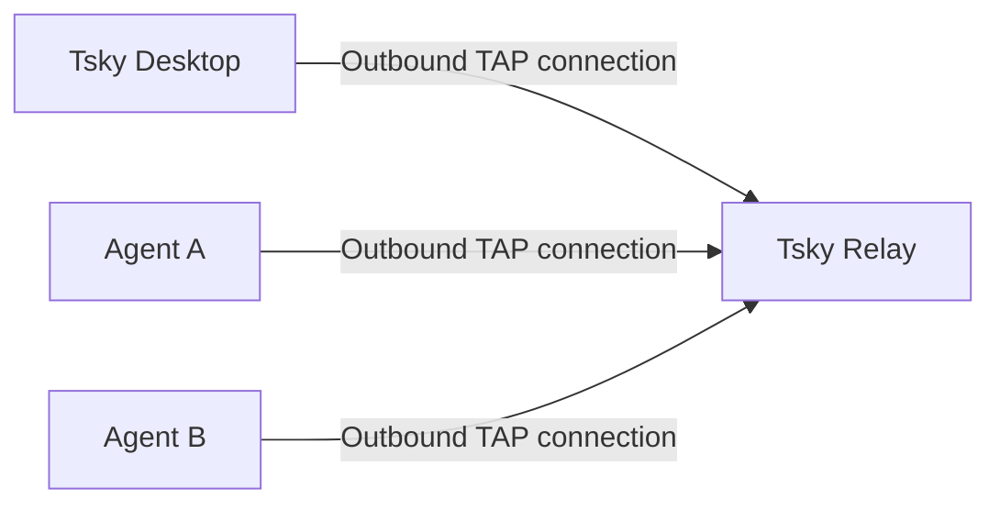
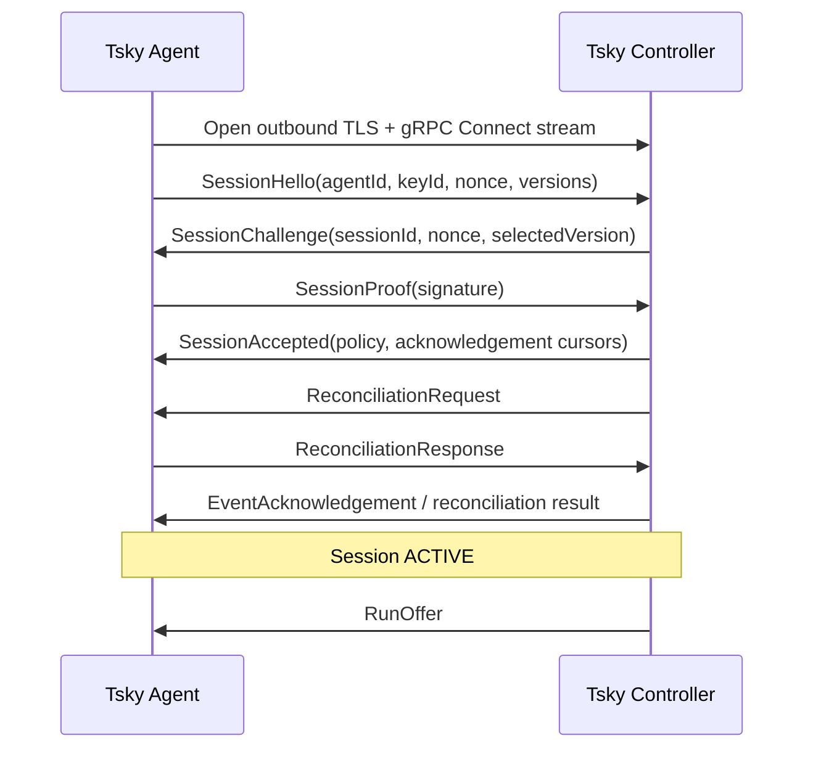
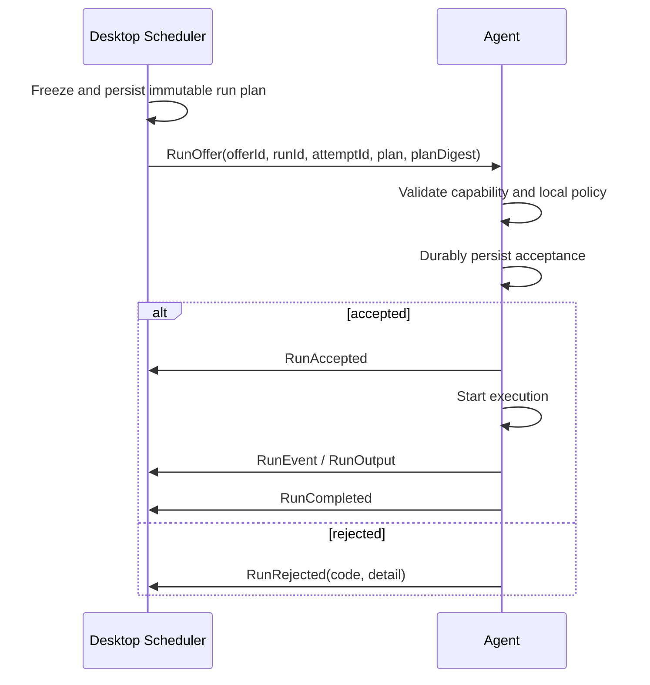

# Tsky Remote Agent Technical Specification

**Status:** Proposed  
**Revision:** 0.2  
**Date:** 2026-07-17  
**Target:** Tsky Windows desktop application and cross-platform Tsky Agent  
**Reference implementations:** C#/.NET controller and Go agent  
**Protocol:** Tsky Agent Protocol (TAP) v1 draft  
**Protocol design:** Language-neutral semantic core with named transport bindings  
**Decision owner:** Tsky project
**Companion draft IDL:** `tap-v1-draft.proto`  

---
## 1. Executive summary

Tsky should add a remote execution feature in which one or more **Tsky Agents** establish outbound authenticated connections to the Tsky desktop application and execute immutable task, group, chain, graph, or ritual run plans selected and pushed by the desktop controller.

The remote machine shall not expose a Tsky listening port. The agent initiates the network connection, but the desktop remains the application-level authority:

```text
Agent opens outbound connection
        ↓
Desktop authenticates agent
        ↓
Desktop selects agent and pushes RunOffer
        ↓
Agent durably accepts or rejects
        ↓
Agent executes and reports events
```

The recommended design is:

1. Define a language-neutral **Tsky Agent Protocol (TAP)** with a transport-independent semantic core.
2. Publish the protocol as normative Protocol Buffer v3 definitions, state-transition rules, test vectors, and conformance requirements.
3. Make **TAP-gRPC/1** the required v1 control binding:
   - Native gRPC over HTTP/2 and TLS.
   - One long-lived bidirectional `Connect` stream.
   - The agent is the network client and opens the connection outbound.
   - The desktop is the controller and pushes work over the established stream.
4. Define **TAP-WebSocket/1** as an optional compatibility binding using the same TAP messages and state machine where native HTTP/2 or gRPC is unavailable.
5. Use HTTPS for initial enrolment, controller discovery, health, and large artifact transfer.
6. Use a one-time enrolment token only as a bootstrap credential.
7. During enrolment, have the agent generate a device key pair locally and register the public key with the controller.
8. Authenticate later sessions with TLS server authentication plus application-level proof of possession. Optional mTLS may be supported where end-to-end TLS is available.
9. Store durable runtime data in versioned files and append-only event logs, consistent with Tsky's local-first design.
10. Assign an entire immutable run plan to one execution target for the first release. Do not initially distribute individual steps across multiple agents.
11. Add an **Agents** section to the desktop UI showing enrolment state, connectivity, load, capabilities, current work, recent runs, protocol compatibility, and security status.
12. Treat the Go agent and C# controller as reference implementations, not as the definition of the protocol.
13. Permit future implementations in Rust, Java, Python, C++, or another language by conforming to the published IDL, security profile, state machine, and test vectors.
14. Treat A2A as a future external integration boundary rather than the worker protocol.

### 1.1 Protocol composition

TAP is purpose-built, but it should not invent every concept independently. It selectively adopts proven ideas from established protocols:

| Source | Concepts adopted | Concepts deliberately not adopted |
|---|---|---|
| gRPC | Bidirectional streaming, HTTP/2 flow control, status model, TLS integration, cross-language service definitions | gRPC transport semantics are not treated as Tsky execution semantics; automatic RPC retry must not duplicate runs |
| Protocol Buffers | Language-neutral IDL, extensible field numbering, binary encoding, standard JSON mapping | Generated classes are not the normative behaviour; the TAP state machine remains normative |
| Bazel Remote Execution API | Immutable action/command/result thinking, content digests, platform requirements, declared outputs | Mandatory CAS, build-cache semantics, hermetic-build assumptions, and full REAPI compatibility |
| Bazel Remote Worker API | Worker-to-scheduler relationship and worker capability matching | Lease-polling model and heavyweight worker API surface |
| A2A | Discoverable capability/card ideas, explicit task states, artifacts, protocol interface declarations | Conversational messages, autonomous-agent semantics, and A2A Task identity |
| OAuth Device Authorization Grant | Optional future human-approved device enrolment pattern | Requiring an OAuth authorisation server for the initial local-first release |
| WebSocket | Widely proxyable fallback bidirectional channel | A second semantic protocol or JSON-only implementation fork |
| SSH / WS-Management | Possible executor adapters for machines that already expose those management facilities | Primary TAP control channel |
| MQTT / AMQP | Possible future relay or broker backplane | Required broker in the desktop-to-agent MVP |

Adopting a concept does not imply wire compatibility or conformance with the source protocol. TAP shall clearly distinguish **inspiration**, **profile reuse**, and **formal compatibility**.

### 1.2 Why TAP is still required

There is no single widely adopted standard that simultaneously defines:

- Device enrolment.
- Outbound worker connections.
- Controller-pushed assignments.
- Machine capabilities and load.
- Exact process execution.
- Tsky task and ritual semantics.
- Typed port values.
- Durable stdout/stderr replay.
- Reconnection and reconciliation.
- Artifact transfer.
- Local execution policy.
- Agent revocation.

The Bazel Remote Worker API is the nearest domain-specific precedent, but the Remote APIs project itself notes that it is considered too heavyweight for many worker/server implementations. TAP should therefore reuse its sound concepts without adopting the complete model.

### 1.3 A2A position

A2A v1.0 is designed for communication with autonomous or opaque agentic systems. Tsky agents are managed execution workers. Individual Tsky agents shall therefore not be exposed as A2A agents.

A future **Tsky A2A Adapter** may expose the Tsky controller as an A2A server with capabilities such as:

- Execute a named Tsky task.
- Execute a ritual.
- Query a run.
- Cancel a run.
- Retrieve artifacts.

The adapter would translate an A2A request into a normal immutable TAP run and schedule it on a local or remote execution target.

---

## 2. Context and terminology

Tsky is a Windows desktop task launcher that depicts tasks as cards and groups of cards. Tasks can pass values through input and output ports, allowing groups, chains, graphs, and rituals to behave as executable data flows.

The remote execution feature divides Tsky into two logical roles:

| Term | Meaning |
|---|---|
| **Tsky Desktop** | The user-facing control plane, editor, scheduler, history viewer, and source of task definitions. |
| **Tsky Agent** | A remote execution worker that receives immutable run plans, executes them, persists runtime data, and reports results. |
| **Agent Gateway** | The desktop-side network endpoint that enrols agents, accepts persistent connections, dispatches runs, and receives events. |
| **Run plan** | A deep-copied, immutable description of the work to be executed, including task snapshots, dependencies, inputs, policies, and expected outputs. |
| **Run** | A concrete execution of one run plan. |
| **Task** | A Tsky task-card definition or immutable snapshot of that definition. |
| **Ritual** | A Tsky workflow made from owned task snapshots and stable step identifiers. |
| **Controller** | The logical service that owns agent definitions and run assignments. Initially this is hosted inside the desktop process. |
| **Execution target** | Local desktop runtime, a named remote agent, or an agent pool. |
| **Agent pool** | A named set of agents eligible for automatic scheduling. |

The word **agent** in this specification means a managed execution worker. It does not imply an LLM, autonomous planner, or AI agent.

An internal code term such as `Runner` or `Worker` may be preferable where ambiguity with AI agents would otherwise make code difficult to understand. The UI can continue to use **Agents**.

---

## 3. Goals

The feature shall:

- Allow the desktop application to define, enrol, revoke, and inspect remote agents.
- Allow agents to connect from LANs, VPNs, tunnels, and eventually a relay service.
- Avoid requiring inbound ports on agent machines.
- Secure every remote connection.
- Execute existing Tsky run semantics remotely without creating a separate task model.
- Preserve stable task, ritual-step, port, run, and history identifiers.
- Stream status and output while also persisting it durably.
- Recover safely after desktop, network, or agent interruption.
- Expose agent status, load, capabilities, and version compatibility in the UI.
- Support Windows and Linux agents.
- Keep runtime storage local and inspectable.
- Permit an agent to finish an already accepted run while temporarily disconnected.
- Make duplicate protocol messages and reconnects safe.
- Make future extraction of the controller from the desktop process possible.
- Leave a clear extension point for a future A2A adapter.

---

## 4. Non-goals for the first release

The first release shall not attempt to provide:

- Arbitrary AI-agent collaboration.
- An A2A-compatible worker protocol.
- Multi-controller clustering.
- A public hosted Tsky relay service.
- Per-step scheduling of one ritual or graph across several agents.
- Exactly-once distributed execution.
- A full operating-system security sandbox.
- Container orchestration.
- Kubernetes integration.
- Automatic agent binary update.
- Multi-tenant enterprise identity.
- Human OAuth login on the agent.
- Secret synchronisation between the desktop and agents.
- Remote interactive terminal sessions.
- Peer-to-peer agent communication.
- Agent-to-agent load balancing.
- A central database.
- Guaranteed continuation when the agent host reboots unless the task type explicitly supports recovery.

---

## 5. Protocol standards and composition assessment

### 5.1 Evaluation criteria

A candidate protocol or protocol family is relevant only if it helps with one or more of:

- Language-neutral message definitions.
- Agent-initiated outbound connectivity.
- Controller-pushed commands.
- Bidirectional event streaming.
- Device enrolment and identity.
- Capability declaration.
- Run lifecycle.
- Idempotency and reconciliation.
- Artifact transfer.
- Operational interoperability.

No candidate is assumed to solve the entire problem.

### 5.2 gRPC and Protocol Buffers

gRPC is the recommended primary binding because a bidirectional streaming RPC allows both sides to send ordered message sequences independently over one established HTTP/2 connection.

This fits Tsky without requiring an agent listening port:

```text
Tsky Agent:      gRPC client, outbound connector, execution worker
Tsky Desktop:    gRPC server, reachable endpoint, scheduling controller
```

The words `client` and `server` describe who opens and accepts the network connection. They do not define who controls the work.

Protocol Buffers are suitable as the canonical IDL because they are language-neutral, platform-neutral, extensible, and supported by many languages. TAP shall use conservative proto3 features to maximise implementation support.

**Adopt:**

- Bidirectional streaming.
- Per-direction ordering.
- HTTP/2 flow control.
- TLS support.
- Protobuf messages and services.
- Standard gRPC status codes for transport/RPC failures.
- Proto field compatibility rules.

**Do not assume:**

- A successful gRPC write means a run was durably accepted.
- A reconnect means the preceding run failed.
- An RPC retry is safe for a non-idempotent command.
- gRPC health and keepalive replace TAP heartbeats or run reconciliation.

### 5.3 Bazel Remote Execution API

The Remote Execution API defines execution around immutable `Action`, `Command`, platform, digest, and result concepts. It is designed primarily for remote build and test execution backed by content-addressable storage and optional caching.

TAP should borrow:

- Immutable execution descriptions.
- Separation of command from action/run metadata.
- Declared outputs.
- Content digests.
- Platform/capability requirements.
- Explicit result and status data.
- Retry information as structured metadata.

TAP should not initially require:

- A content-addressable store.
- Merkle-tree filesystem inputs.
- Action caching.
- Hermetic or reproducible execution.
- REAPI's client-facing execution service.
- REAPI wire compatibility.

A future executor may map a Tsky step to a REAPI action when a REAPI execution backend is available.

### 5.4 Bazel Remote Worker API

The Remote Worker API is directly relevant because it defines generic worker/server communication. However, the Remote APIs project describes it as too heavyweight for many use cases and documents that many implementations created their own worker protocols.

TAP should borrow:

- The scheduler-to-worker distinction.
- Worker capabilities and properties.
- Durable ownership of assigned execution.
- Explicit acceptance and completion.
- Reconciliation between worker and scheduler.

TAP should not use a worker pull or lease-polling mechanism in v1. The desktop shall push assignments through the already established outbound stream.

### 5.5 A2A

A2A contributes useful interoperability ideas:

- A discoverable card describing identity, interfaces, capabilities, and authentication.
- Explicit task states.
- Structured artifacts.
- Protocol/interface version declarations.
- Optional OAuth security declarations.

TAP may adopt a smaller **Controller Descriptor** and **Agent Capability Document** inspired by Agent Cards.

TAP shall not adopt:

- Conversational message history.
- AI-agent skill negotiation.
- A2A Task identity.
- Autonomous delegation semantics.
- A2A server reachability on each remote agent.

A2A remains an adapter at the controller boundary.

### 5.6 OAuth Device Authorization Grant

OAuth Device Authorization Grant is useful when an input-constrained or CLI device needs user approval using a browser on another device.

For the first local-first Tsky release:

- Use a controller-generated one-time enrolment token.
- Register a device-generated public key.
- Do not require an OAuth server.

For a future enterprise profile:

- Device Authorization Grant may provide human approval.
- Client Credentials may support managed service identities.
- OIDC may govern administrative access to the controller.
- TAP device identity and run authorisation still remain distinct concerns.

### 5.7 WebSocket

WebSocket remains an optional transport binding because it is widely supported through tunnels and reverse proxies.

The WebSocket binding shall:

- Carry the same TAP frame messages.
- Use the same session, authentication, run, and reconciliation state machines.
- Use Protocol Buffer binary messages by default.
- Optionally use ProtoJSON for diagnostic interoperability.
- Advertise subprotocol `tsky.tap.v1.protobuf` or `tsky.tap.v1.json`.
- Never introduce WebSocket-only execution semantics.

### 5.8 SSH and WS-Management

SSH and WS-Management are controller-to-machine management protocols, but they require a service on the remote machine and do not define Tsky scheduling or run reconciliation.

They may be implemented as Tsky executors:

- `ssh.v1`
- `winrm.v1`

They are not TAP bindings.

### 5.9 MQTT and AMQP

MQTT and AMQP standardise brokered messaging and may be valuable when a relay or store-and-forward controller is introduced.

They are not required for the MVP because they add:

- A broker process or service.
- Broker identity and authorisation.
- Topic or queue lifecycle.
- Duplicate-delivery handling at another layer.
- Operational deployment overhead.

A future `TAP-MQ/1` binding may map TAP frames to broker messages without changing the TAP core.

### 5.10 Decision

Use a **composed protocol architecture**:

1. TAP Core defines semantics and state transitions.
2. Proto3 defines the canonical messages.
3. TAP-gRPC/1 defines the required persistent control binding.
4. TAP-HTTPS/1 defines enrolment, discovery, and large artifact transfer.
5. TAP-WebSocket/1 is an optional fallback binding.
6. REAPI, Remote Worker API, and A2A provide selected domain concepts.
7. OAuth, SSH, WS-Man, MQTT, and AMQP remain optional profiles or adapters.

---

## 6. Architecture decisions

### ADR-001: Use Go for the reference remote agent

**Decision:** Implement the first Tsky Agent in Go 1.26 or a later supported Go version.

**Rationale:**

- Single-binary deployment.
- Good Windows and Linux support.
- Strong networking, TLS, process, filesystem, hashing, and cryptography libraries.
- Straightforward Windows service and `systemd` integration.
- Low idle resource usage.
- Natural concurrency model for connection, execution, output, and heartbeat loops.
- Easy cross-compilation.

**Constraint:** Go is a reference implementation choice, not a protocol requirement.

A conforming TAP agent may be written in any language that can implement the required security, message, transport, persistence, and process semantics.

### ADR-002: Define a transport-independent TAP Core

**Decision:** Define `Tsky Agent Protocol (TAP) v1` independently of any implementation language and independently of gRPC method handlers.

TAP Core shall normatively define:

- Roles.
- Identifiers.
- Session state machine.
- Agent state machine.
- Run-attempt state machine.
- Messages and field semantics.
- Authentication transcript.
- Ordering and idempotency.
- Reconciliation.
- Error codes.
- Limits.
- Extension and compatibility rules.

### ADR-003: Use Protocol Buffers v3 as the canonical IDL

**Decision:** Publish `.proto` files as the canonical message and service definitions.

**Rationale:**

- Language-neutral and platform-neutral.
- Mature support in C#, Go, Java, Python, C++, Rust, and other languages.
- Stable binary encoding.
- Defined compatibility practices.
- Standard JSON mapping.
- Suitable for gRPC and non-gRPC bindings.

**Constraint:** Generated code does not supersede the written TAP state-transition rules.

### ADR-004: Make TAP-gRPC/1 the required control binding

**Decision:** Use native bidirectional gRPC over HTTP/2 and TLS.

Normative service shape:

```protobuf
service AgentControl {
  rpc Connect(stream AgentFrame) returns (stream ControllerFrame);
}
```

The agent opens the stream. The desktop sends commands over the server-to-client direction of the same stream.

### ADR-005: Agents expose no Tsky listening ports

The remote agent shall not listen on a network interface in v1.

The agent shall initiate:

- Enrolment HTTPS requests.
- The persistent gRPC control stream.
- Artifact uploads.
- Diagnostic connectivity checks.
- Optional relay connections.

### ADR-006: Controller pushes assignments; agents do not poll for work

The desktop scheduler selects the execution target and sends `RunOffer` over the established stream.

The agent may accept or reject the offer according to:

- Capacity.
- Capability.
- Disk pressure.
- Draining state.
- Version compatibility.
- Local execution policy.

The protocol shall not use periodic work polling or a lease claim loop in v1.

### ADR-007: Define TAP-WebSocket/1 as an optional fallback binding

A WebSocket implementation may be used where gRPC or HTTP/2 proxy support is unsuitable.

It must carry the same TAP frames and obey the same state machines, ordering, security, and conformance tests.

### ADR-008: Bootstrap with a one-time token, then use asymmetric identity

The desktop-generated enrolment token shall:

- Contain at least 256 bits of cryptographically secure randomness.
- Be Base64URL encoded.
- Expire after 15 minutes by default.
- Be single-use.
- Be stored by the desktop only as a cryptographic hash.
- Be bound to a pending agent definition.
- Never become the long-lived connection credential.

The agent shall generate an ECDSA P-256 key pair locally. The public key is registered during enrolment. Subsequent sessions use proof of possession.

### ADR-009: Keep the control plane abstracted from the UI process

The first implementation may host Kestrel and the controller inside the Tsky desktop process, but UI code shall depend on an `IAgentControlPlane` abstraction.

This permits later extraction into a headless `Tsky.Controller` service without changing task-editing or agent UI semantics.

### ADR-010: Assign a complete run plan to one execution target

For the first release, a task, group, chain, graph, or ritual run shall execute entirely:

- Locally, or
- On one named agent, or
- On one agent selected from a pool.

Individual steps shall not move between agents during a run.

### ADR-011: Use file-based durable runtime storage

The agent shall store run state, events, output, and artifacts in files. State changes shall use atomic replacement and append-only event records.

SQLite may be introduced later if query volume, contention, or retention requirements make file scanning unsuitable.

### ADR-012: Separate protocol compatibility from implementation version

Every session shall negotiate:

- TAP major and minor version.
- Binding profile and version.
- Agent implementation version.
- Supported executor capabilities.
- Supported optional TAP features.

A newer binary is not automatically protocol-compatible, and an older binary is not automatically incompatible.

### ADR-013: Use conformance tests as part of the protocol

The protocol repository shall include:

- Descriptor sets.
- Binary fixtures.
- ProtoJSON fixtures.
- Authentication test vectors.
- State-machine traces.
- Invalid-message fixtures.
- Expected error codes.

A new language implementation is conforming only when it passes the applicable profile test suite.

---

## 7. Logical architecture



### 7.1 Network and authority direction

The agent is the network initiator:

```text
Agent → opens outbound connection → Controller
```

The controller is the scheduling authority:

```text
Controller → pushes RunOffer → Agent
```

These directions are intentionally different. The agent does not need a listening port and does not pull work from a queue.

### 7.2 Responsibility split

The desktop is authoritative for:

- Agent definitions.
- Pending enrolments.
- Agent trust and revocation.
- Task and ritual definitions.
- Immutable run-plan creation.
- Scheduling decisions.
- Assignment intent.
- Final run history and user-visible status.
- Retention settings applied to desktop copies.
- User approvals and cancellation requests.

The agent is authoritative for:

- Its private identity key.
- Its host metadata and capabilities.
- Its actual local process state.
- Durable acceptance of an offered attempt.
- Durable runtime events not yet acknowledged by the desktop.
- Local stdout and stderr.
- Local working directories and generated artifacts.
- Enforcement of agent-local execution policy.
- Accurate exit code and termination reason.

Neither side shall infer execution success, failure, or cancellation solely from connection state.

---

## 8. Deployment topologies

### 8.1 Direct LAN

The desktop binds the TAP gateway to a LAN interface. Agents connect outbound using native gRPC over TLS.

This is the simplest development and home-network topology.

The remote agent requires no inbound firewall rule. The desktop host requires an inbound rule restricted to the intended private network.

### 8.2 Private VPN or mesh network

The desktop and agents communicate over private VPN or mesh addresses.

This is the preferred initial topology for machines at different locations because:

- The desktop endpoint is not generally public.
- Native HTTP/2 can be used end to end.
- TLS server identity is easier to manage.
- Agent hosts still expose no Tsky ports.

### 8.3 Reverse tunnel

A reverse tunnel publishes the desktop gateway endpoint. The agent connects outbound to the public endpoint.

The tunnel must support:

- Native HTTP/2 gRPC.
- Long-lived streaming requests.
- Sufficient idle timeout.
- TLS and SNI behaviour compatible with the configured controller identity.

If native gRPC is unreliable through the selected tunnel, the optional TAP-WebSocket/1 binding may be used.

TLS may terminate at the tunnel provider. Application-level device proof is therefore required even when direct deployments also support mTLS.

### 8.4 Future Tsky Relay

When neither desktop nor agent should expose a reachable endpoint, both connect outbound to a relay:



The relay must not become the source of task definitions or run truth.

A hosted relay should eventually provide end-to-end message integrity and, where practical, end-to-end payload encryption so that relay compromise does not permit command substitution.

### 8.5 Controller discovery and endpoints

Recommended default direct gateway port: `7341`, configurable.

#### Required TAP-gRPC/1 service

| Service method | Purpose |
|---|---|
| `tsky.agent.v1.AgentControl/Connect` | Long-lived bidirectional control stream opened by the agent. |

#### TAP-HTTPS/1 endpoints

| Endpoint | Purpose |
|---|---|
| `POST /api/agent/v1/enrol` | One-time agent enrolment. |
| `POST /api/agent/v1/runs/{runId}/artifacts/{artifactId}` | Artifact upload using a short-lived upload grant. |
| `GET /api/agent/v1/health` | Gateway health; must not expose agent data. |
| `GET /.well-known/tsky-controller.json` | Controller identity, supported TAP versions, bindings, and enrolment information. |

Example controller descriptor:

```json
{
  "controllerId": "ctl_01J...",
  "displayName": "Matthew's Tsky",
  "tapVersions": ["1.0"],
  "bindings": [
    {
      "profile": "tap-grpc",
      "version": "1",
      "endpoint": "https://controller.example:7341"
    },
    {
      "profile": "tap-websocket",
      "version": "1",
      "endpoint": "wss://controller.example:7341/api/agent/v1/connect",
      "optional": true
    }
  ],
  "enrolmentEndpoint": "https://controller.example:7341/api/agent/v1/enrol",
  "serverKeyThumbprint": "sha256/..."
}
```

The descriptor is inspired by A2A Agent Cards but is not an A2A Agent Card.

### 8.6 Binding defaults

The desktop shall bind to loopback by default.

Listening on a non-loopback address must be an explicit user action and must display:

- Active endpoint.
- Network scope.
- TLS status.
- Certificate identity.
- Supported TAP binding.
- Whether a relay or tunnel is involved.

---

## 9. Desktop-side components

The following names are conceptual and should be mapped to the existing Tsky solution structure rather than forcing an unnecessary project reorganisation.

### 9.1 `IAgentControlPlane`

Provides the application-facing API:

```csharp
public interface IAgentControlPlane
{
    Task<IReadOnlyList<AgentSummary>> ListAgentsAsync(
        CancellationToken cancellationToken);

    Task<PendingEnrollment> CreatePendingAgentAsync(
        CreateAgentRequest request,
        CancellationToken cancellationToken);

    Task RevokeAgentAsync(
        AgentId agentId,
        CancellationToken cancellationToken);

    Task<RunAssignment> DispatchAsync(
        ImmutableRunPlan plan,
        ExecutionTarget target,
        CancellationToken cancellationToken);

    Task CancelRunAsync(
        RunId runId,
        CancellationToken cancellationToken);

    IAsyncEnumerable<AgentControlEvent> WatchEventsAsync(
        CancellationToken cancellationToken);
}
```

### 9.2 `AgentRegistry`

Responsibilities:

- Persist agent definitions separately from transient connection state.
- Store registered public keys and key identifiers.
- Store revocation state.
- Resolve agent pools and tags.
- Record last known capabilities and version.
- Never store plaintext enrolment tokens.

### 9.3 `EnrollmentService`

Responsibilities:

- Generate one-time tokens.
- Hash tokens before persistence.
- Validate token expiry and one-use semantics atomically.
- Bind an enrolment to the pending definition.
- Validate controller identity and protocol compatibility.
- Register the device public key.
- Produce an audit event.
- Invalidate the token on successful enrolment.

### 9.4 `AgentSessionManager`

Responsibilities:

- Track active TAP sessions independently of their transport binding.
- Ensure one authoritative session per `agentId` and `keyId`.
- Authenticate the session.
- Maintain heartbeat and last-seen state.
- Dispatch messages through bounded queues.
- Enforce a single ordered writer for each outbound gRPC stream direction.
- Reconcile active runs after reconnect.
- Coalesce high-frequency telemetry before notifying the UI.

### 9.5 `RemoteRunScheduler`

Responsibilities:

- Resolve explicit agent or pool targets.
- Validate capabilities before offering a run.
- Persist assignment intent before sending it.
- Use run and offer identifiers for idempotency.
- Avoid automatic duplicate execution after uncertain failure.
- Handle agent drain and capacity.
- Keep local execution available through the same scheduling abstraction.

### 9.6 `RunEventStore`

Responsibilities:

- Append run events durably.
- Deduplicate by `runId` and event sequence.
- Correlate ritual history using `ritualRunId`.
- Preserve stable step identifiers.
- Materialise current run state for UI queries.
- Retain raw events for diagnostics.

### 9.7 `AgentGatewayHost`

Initially an in-process ASP.NET Core/Kestrel host.

Requirements:

- Start and stop independently of the main window lifecycle code.
- Use dependency injection and hosted services.
- Enforce request, message, stream, and artifact limits.
- Host native gRPC and HTTPS endpoints through Kestrel.
- Enforce TLS in non-development modes.
- Rate-limit enrolment and unauthenticated connection attempts.
- Expose no task-definition editing endpoints.
- Be extractable into a separate process later.

### 9.8 UI integration

The existing main window should not directly manage sockets or protocol frames. The feature should help reduce, not increase, responsibility in `MainWindow.xaml.cs`.

Use view models and services such as:

- `AgentsNavigationViewModel`
- `AgentsListViewModel`
- `AgentDetailsViewModel`
- `EnrollmentWizardViewModel`
- `ExecutionTargetPickerViewModel`
- `AgentRunHistoryViewModel`

---

## 10. Go agent components

Suggested repository layout:

```text
agent/
  cmd/
    tsky-agent/
      main.go
  internal/
    config/
    identity/
    enrolment/
    transport/
    protocol/
    connection/
    execution/
    process/
    runtimefs/
    telemetry/
    policy/
    artifacts/
    diagnostics/
    platform/
      windows/
      linux/
  schemas/
  tests/
  go.mod
```

### 10.1 Configuration loader

- Read a versioned JSON or YAML configuration file.
- Apply environment-variable overrides only to non-secret values.
- Reject unknown security-sensitive fields unless explicitly supported.
- Validate paths and limits before connecting.
- Support a `tsky-agent validate-config` command.

### 10.2 Identity manager

- Generate an ECDSA P-256 key pair.
- Store the private key using the strongest available platform mechanism.
- Never print or export the private key by default.
- Sign session challenges.
- Support key rotation.
- Maintain controller trust information and optional server-certificate pinning.

### 10.3 Connection manager

- Perform enrolment.
- Establish outbound TAP-gRPC/1 connections and optionally TAP-WebSocket/1 connections.
- Authenticate sessions.
- Apply exponential backoff with full jitter.
- Send heartbeats and state snapshots.
- Maintain bounded inbound and outbound queues.
- Persist run events before attempting transmission.
- Resume from the desktop's last acknowledged sequence.
- Keep transport reconnection separate from run retry decisions.

### 10.4 Execution engine

- Validate run-plan schema and hash.
- Check executor capability and local policy.
- Persist the accepted run before acknowledging it.
- Create the working directory.
- Resolve input ports and local artifact references.
- Execute task steps according to the immutable plan.
- Record step and run state transitions.
- Stream output without making output delivery a prerequisite for process progress.
- Generate output-port values and artifact manifests.

### 10.5 Process supervisor

- Prefer executable plus argument-array execution.
- Require an explicit executor type for shell-string commands.
- Capture stdout and stderr separately.
- Apply timeout and cancellation policy.
- Terminate the full process tree.
- Record executable path, arguments after redaction, PID, start time, exit code, and termination reason.
- Use Windows Job Objects on Windows.
- Use process groups and, where configured, `systemd` scopes or cgroups on Linux.

### 10.6 Runtime file store

- Use atomic writes for snapshots.
- Use append-only NDJSON for event streams.
- Use file locks or single-writer ownership.
- Store output before streaming it.
- Recover incomplete runs on startup.
- Enforce retention and disk-space thresholds.

### 10.7 Telemetry collector

At minimum report:

- Hostname.
- Operating system and version.
- Architecture.
- Agent version.
- Protocol version range.
- Uptime.
- Active and maximum runs.
- CPU load.
- Memory used and available.
- Runtime-store free disk space.
- Draining state.
- Supported executor identifiers and versions.

Telemetry is operational data, not a remote monitoring product. It should be sampled conservatively and coalesced.

---

## 11. Agent domain model

### 11.1 `AgentDefinition`

```json
{
  "schemaVersion": 1,
  "agentId": "agt_01J...",
  "name": "Build Server",
  "description": "Windows build and packaging agent",
  "enabled": true,
  "trustState": "registered",
  "tags": ["windows", "build", "x64"],
  "poolIds": ["default", "windows-build"],
  "maxConcurrentRunsOverride": 2,
  "createdAt": "2026-07-17T18:00:00Z",
  "registeredAt": "2026-07-17T18:04:12Z",
  "revokedAt": null
}
```

Definitions are desktop-owned. They must not be overwritten by heartbeat data.

### 11.2 `AgentIdentity`

```json
{
  "schemaVersion": 1,
  "agentId": "agt_01J...",
  "controllerId": "ctl_01J...",
  "keyId": "key_01J...",
  "algorithm": "ES256",
  "publicKeyJwk": {
    "kty": "EC",
    "crv": "P-256",
    "x": "...",
    "y": "..."
  },
  "createdAt": "2026-07-17T18:04:12Z",
  "notAfter": null,
  "revoked": false
}
```

### 11.3 `AgentRuntimeStatus`

```json
{
  "agentId": "agt_01J...",
  "connectionState": "online",
  "availabilityState": "busy",
  "lastSeenAt": "2026-07-17T18:08:43Z",
  "sessionId": "ses_01J...",
  "agentVersion": "0.1.0",
  "protocolVersion": "1.0",
  "hostname": "BUILD-01",
  "os": "windows",
  "architecture": "amd64",
  "activeRuns": 1,
  "maxConcurrentRuns": 2,
  "cpuPercent": 38.4,
  "memoryUsedBytes": 6417285120,
  "memoryTotalBytes": 17179869184,
  "runtimeDiskFreeBytes": 122728271872,
  "draining": false
}
```

### 11.4 Agent states

| State | Meaning |
|---|---|
| `pending` | Defined on the desktop but not enrolled. |
| `enrolling` | Enrolment is in progress. |
| `online` | Authenticated and able to accept work. |
| `busy` | Online with one or more active runs. |
| `draining` | Online but refusing new work. |
| `degraded` | Connected but has a policy, disk, executor, or version problem. |
| `incompatible` | Protocol or required capability mismatch. |
| `offline` | No authenticated session within the offline threshold. |
| `revoked` | Identity is no longer authorised. |
| `disabled` | Definition is intentionally disabled. |

`disabled`, `revoked`, `incompatible`, and `offline` must remain distinct states.

---

## 12. Enrolment and authentication

### 12.1 Threat model

The security design must address:

- Theft of an enrolment command from clipboard or shell history.
- Replay of enrolment requests.
- Copying an agent configuration directory to another machine.
- Man-in-the-middle interception.
- A malicious or compromised agent.
- A malicious process attempting to impersonate the desktop.
- Replay of session-authentication messages.
- Stolen upload grants.
- Unbounded unauthenticated gRPC or WebSocket connections.
- Revoked agents reconnecting.
- Log or error-message disclosure of credentials.
- TLS termination at a reverse proxy.

### 12.2 Controller identity

On first enabling remote agents, the desktop shall create:

- A stable `controllerId`.
- A controller trust record.
- A TLS configuration.
- An application signing or session-verification configuration.

For direct self-signed deployments, the enrolment command shall include the expected server-certificate SHA-256 fingerprint. For publicly trusted certificates, normal PKI validation is preferred.

### 12.3 Pending agent creation

The user creates a pending agent in the UI and supplies:

- Display name.
- Optional description.
- Optional expected hostname.
- Tags.
- Pool membership.
- Maximum concurrency override.
- Optional enrolment approval requirement.

The desktop generates:

- `pendingAgentId`
- One-time token.
- Token expiry.
- Controller URL.
- Controller ID.
- TLS certificate fingerprint when required.

Example command:

```powershell
tsky-agent enrol `
  --controller "https://controller.example:7341" `
  --pending-agent "agt_pending_01J..." `
  --token "tsky_enrol_..." `
  --controller-id "ctl_01J..." `
  --tls-pin "sha256/..."
```

The UI shall make clear that the command grants enrolment authority until it expires.

### 12.4 Agent-side key creation

Before enrolment, the agent shall generate a device identity:

- Algorithm: ECDSA P-256 with SHA-256 (`ES256`).
- Private key: generated and retained locally.
- Public key: encoded as JWK or another precisely specified portable format.
- Key identifier: generated by the controller after registration.

The enrolment token must not encrypt or derive the private key.

### 12.5 Enrolment request

Example:

```json
{
  "protocolVersion": "1.0",
  "pendingAgentId": "agt_pending_01J...",
  "token": "tsky_enrol_...",
  "controllerId": "ctl_01J...",
  "device": {
    "hostname": "BUILD-01",
    "os": "windows",
    "architecture": "amd64",
    "agentVersion": "0.1.0"
  },
  "publicKeyJwk": {
    "kty": "EC",
    "crv": "P-256",
    "x": "...",
    "y": "..."
  },
  "nonce": "base64url-random-value"
}
```

The desktop shall atomically:

1. Find the pending definition.
2. Validate the token hash.
3. Validate expiry.
4. Validate unused status.
5. Validate protocol compatibility.
6. Optionally require user approval.
7. Register the public key.
8. Mark the token used.
9. Return the permanent `agentId`, `keyId`, controller metadata, and connection settings.

A failed or interrupted response must not allow silent double enrolment. The agent should be able to query the result using the pending ID and proof of possession of its private key.

### 12.6 Session authentication

After the agent opens the outbound TAP-gRPC/1 `Connect` stream, or the equivalent optional TAP-WebSocket/1 channel:

1. Agent sends `SessionHello` containing `agent_id`, `key_id`, agent nonce, supported TAP versions, supported bindings, and implementation metadata.
2. Controller validates that the identity is known, enabled, and not revoked.
3. Controller selects a common TAP version and sends `SessionChallenge`.
4. Agent signs the canonical TAP authentication transcript defined in Section 13.10.
5. Agent sends `SessionProof`.
6. Controller verifies the signature and marks the connection authenticated.
7. Controller sends `SessionAccepted` with policy limits and acknowledgement cursors.
8. Controller and agent reconcile durable run state before the session becomes active.

Requirements:

- Nonces must contain at least 128 bits of randomness.
- A challenge expires after 30 seconds.
- Each challenge is single-use.
- Authentication must complete within 10 seconds of stream establishment.
- No run offer may be processed before authentication and reconciliation.
- An unauthenticated connection must have strict message, byte, and time limits.
- The connection is bound to the authenticated identity for its lifetime.
- A transport reconnect requires a new session challenge.

### 12.7 Optional mTLS

Mutual TLS may be added for direct enterprise deployments.

It must be treated as an additional transport-layer control rather than a replacement for:

- Agent registry authorisation.
- Revocation.
- Protocol authentication.
- Run-level policy.

Application-level proof remains valuable when TLS terminates at a tunnel or reverse proxy.

### 12.8 Why OAuth is not the first choice

OAuth is appropriate when:

- A user or organisation delegates access.
- A separate authorisation server exists.
- Scopes, tenant boundaries, federation, and human login are required.
- Agents need enterprise identity lifecycle integration.

For one desktop controller and its owned workers, an OAuth server would add substantial operational complexity without removing the need for device enrolment and revocation.

A later enterprise mode may support:

- OAuth 2.0 Device Authorization Grant for human-assisted enrolment.
- Client Credentials for service identities.
- OIDC federation for controller administration.

### 12.9 Revocation and key rotation

The desktop shall support:

- Immediate agent revocation.
- Immediate closure of active sessions.
- Rejection of future challenges from revoked keys.
- Separate revocation of one key without deleting the agent definition.
- Key rotation initiated from the authenticated agent.
- User-visible key fingerprint and registration date.
- Audit events for enrolment, rotation, and revocation.

---

## 13. Tsky Agent Protocol (TAP) v1

### 13.1 Normative language

The key words **MUST**, **MUST NOT**, **REQUIRED**, **SHALL**, **SHALL NOT**, **SHOULD**, **SHOULD NOT**, **RECOMMENDED**, **MAY**, and **OPTIONAL** are to be interpreted as normative requirements.

TAP behaviour is defined by four kinds of artifact, in descending order of authority:

1. Written TAP state-machine and field semantics in this specification.
2. Canonical `.proto` definitions.
3. Published conformance test vectors.
4. Reference implementation behaviour.

A reference implementation bug does not redefine the protocol.

### 13.2 Protocol layers

TAP is divided into layers:

| Layer | Defines |
|---|---|
| **TAP Core** | Roles, identifiers, state machines, commands, events, ordering, idempotency, reconciliation, errors, and security semantics |
| **TAP Data Model** | Canonical Protocol Buffer messages and enum values |
| **TAP Binding** | Mapping of frames to gRPC, WebSocket, HTTPS, or a future relay transport |
| **TAP Executor Profile** | Meaning of executor-specific run-step payloads such as `process.v1` or `powershell.v1` |
| **TAP Extension** | Optional feature negotiated by an explicit stable extension identifier |

An implementation may replace the transport library, generated-code strategy, storage engine, UI framework, or programming language without changing TAP Core.

### 13.3 Canonical IDL

TAP v1 shall use conservative Protocol Buffers v3 syntax:

```protobuf
syntax = "proto3";

package tsky.agent.v1;
```

Reasons for using proto3 rather than language-specific DTOs:

- It is language-neutral and platform-neutral.
- It supports binary and standard JSON representations.
- Unknown fields can survive forwarding in compatible implementations.
- Field numbers provide durable compatibility.
- gRPC service bindings can be generated in many languages.

The protocol shall avoid language-specific assumptions such as:

- .NET assembly-qualified type names.
- Go interface type tags.
- Native platform path objects.
- Language-specific decimal or date types.
- Unbounded map keys with implementation-defined ordering.
- Exception class names as error codes.

### 13.4 Repository layout

```text
protocol/
  tap/
    v1/
      tap_control.proto
      tap_session.proto
      tap_agent.proto
      tap_run.proto
      tap_artifact.proto
      tap_error.proto
      tap_security.proto
      tap_options.proto
      descriptors/
        tap-v1.pb
      json-schema/
        tap-v1.schema.json
      examples/
        binary/
        protojson/
      test-vectors/
        authentication/
        state-machines/
        invalid-messages/
      conformance/
        README.md
```

The JSON Schema bundle is generated for validation and documentation. The `.proto` files and written semantics remain normative.

### 13.5 Required gRPC service

```protobuf
service AgentControl {
  rpc Connect(stream AgentFrame) returns (stream ControllerFrame);
}
```

The agent calls `Connect`. The controller accepts the stream.

The request and response streams operate independently:

- Agent-to-controller frames carry authentication proofs, status, run events, output, and reconciliation.
- Controller-to-agent frames carry authentication challenges, run offers, cancellation, drain state, acknowledgements, and policy notices.

The controller MAY send a command whenever the authenticated session is active. The agent does not poll for work.

### 13.6 Common frame header

```protobuf
message FrameHeader {
  string protocol = 1;              // "tap"
  ProtocolVersion version = 2;
  string message_id = 3;
  google.protobuf.Timestamp sent_at = 4;
  string correlation_id = 5;
  uint64 sequence = 6;
  map<string, string> metadata = 7;
}
```

Rules:

- `protocol` MUST equal `tap`.
- `message_id` MUST be unique within the sender's retained deduplication window.
- `sent_at` is diagnostic and MUST NOT be the sole ordering authority.
- `correlation_id` identifies a session, offer, run, attempt, artifact, or another protocol object.
- `sequence` is meaningful only for message types that define a monotonic sequence.
- Metadata keys beginning with `tap.` are reserved.
- Security-sensitive semantics MUST use typed fields rather than metadata.

### 13.7 Direction-specific frames

```protobuf
message AgentFrame {
  FrameHeader header = 1;

  oneof body {
    SessionHello session_hello = 10;
    SessionProof session_proof = 11;
    AgentSnapshot agent_snapshot = 12;
    AgentHeartbeat agent_heartbeat = 13;
    CapabilityReport capability_report = 14;
    RunAccepted run_accepted = 20;
    RunRejected run_rejected = 21;
    RunEvent run_event = 22;
    RunOutput run_output = 23;
    RunCompleted run_completed = 24;
    ReconciliationResponse reconciliation_response = 25;
    ArtifactUploadCompleted artifact_upload_completed = 30;
    ProtocolPong pong = 40;
  }
}

message ControllerFrame {
  FrameHeader header = 1;

  oneof body {
    SessionChallenge session_challenge = 10;
    SessionAccepted session_accepted = 11;
    SessionRejected session_rejected = 12;
    RunOffer run_offer = 20;
    CancelRun cancel_run = 21;
    EventAcknowledgement event_acknowledgement = 22;
    ReconciliationRequest reconciliation_request = 23;
    DrainRequest drain_request = 24;
    ArtifactUploadGrant artifact_upload_grant = 30;
    PolicyNotice policy_notice = 31;
    ProtocolPing ping = 40;
    ProtocolError protocol_error = 41;
  }
}
```

Unknown `oneof` cases shall be handled as unsupported messages, not as process instructions.

### 13.8 Session state machine

Controller-side session states:

```text
CONNECTED
  → AWAITING_HELLO
  → CHALLENGE_SENT
  → AUTHENTICATED
  → RECONCILING
  → ACTIVE
  → CLOSING
  → CLOSED
```

Agent-side session states:

```text
DISCONNECTED
  → CONNECTING
  → HELLO_SENT
  → PROOF_SENT
  → AUTHENTICATED
  → RECONCILING
  → ACTIVE
  → BACKOFF
```

Rules:

- The first agent frame MUST be `SessionHello`.
- No run offer may be sent before authentication succeeds.
- No run may start before reconciliation completes or is explicitly skipped for a new agent.
- A second `SessionHello` on an authenticated stream is a protocol error.
- Only one authoritative active session per `agent_id` and `key_id` is allowed unless a future negotiated extension permits otherwise.
- Closing the stream does not imply cancellation of accepted runs.

### 13.9 Session establishment sequence



### 13.10 Authentication transcript

The agent signs the exact UTF-8 bytes of this canonical transcript:

```text
TSKY-TAP-AUTH-V1
controller_id=<controllerId>
agent_id=<agentId>
key_id=<keyId>
session_id=<sessionId>
agent_nonce=<base64url>
controller_nonce=<base64url>
tap_version=<major.minor>
binding=<binding-profile>
issued_at=<RFC3339 UTC>
```

Requirements:

- Field order and line endings are fixed as shown.
- Values MUST NOT contain newline characters.
- Nonces contain at least 128 bits of cryptographically secure randomness.
- Challenges expire after 30 seconds.
- A challenge is single-use.
- Initial algorithm: ECDSA P-256 with SHA-256.
- Signature encoding MUST be explicitly defined in `tap_security.proto`; the v1 profile shall use IEEE P1363 fixed-width `r || s` encoding to avoid DER ambiguity.
- Public keys shall be represented as JWK-compatible EC coordinates in enrolment documents.
- A future algorithm requires a negotiated security-profile identifier.

### 13.11 Controller-pushed assignment

TAP v1 uses controller push, not worker pull.



`RunOffer` is used rather than an unconditional `RunCommand` because an agent must be able to reject work that is invalid, unsafe, incompatible, or beyond capacity.

### 13.12 Run identifiers

| Identifier | Meaning |
|---|---|
| `run_id` | Logical Tsky run |
| `attempt_id` | One concrete execution attempt |
| `offer_id` | One scheduling offer sent to an agent |
| `plan_digest` | SHA-256 digest of canonical execution-relevant run-plan bytes |
| `ritual_run_id` | Correlation identifier for a ritual execution |
| `step_id` | Stable step identity inside the immutable plan |
| `event_sequence` | Monotonic sequence within an attempt |
| `output_sequence` | Monotonic sequence within a stream and attempt |

The tuple `(run_id, attempt_id, plan_digest)` is the primary idempotency identity for execution.

### 13.13 Run-attempt state machine

```text
OFFERED
  ├── REJECTED
  └── ACCEPTED
        → PREPARING
        → RUNNING
        ├── CANCELLING
        │     ├── CANCELLED
        │     └── FAILED
        ├── SUCCEEDED
        ├── FAILED
        ├── TIMED_OUT
        └── INTERRUPTED
```

Rules:

- `OFFERED` is controller-local until received.
- `ACCEPTED` must be persisted before the agent sends `RunAccepted`.
- Terminal states are `REJECTED`, `CANCELLED`, `SUCCEEDED`, `FAILED`, `TIMED_OUT`, and `INTERRUPTED`.
- A terminal attempt MUST NOT return to a non-terminal state.
- Cancellation is a request, not proof of cancellation.
- Disconnect is not a run state.
- The agent MUST reject the same `run_id` and `attempt_id` with a different `plan_digest`.
- Receiving the same tuple again MUST return the existing attempt state without starting another process.

### 13.14 Run offer model

```protobuf
message RunOffer {
  string offer_id = 1;
  string run_id = 2;
  string attempt_id = 3;
  bytes plan_digest_sha256 = 4;
  RunPlan plan = 5;
  google.protobuf.Timestamp offer_expires_at = 6;
  DisconnectPolicy disconnect_policy = 7;
}
```

The run plan adopts REAPI-style separation of immutable command data from execution metadata, but it is a Tsky object rather than a REAPI `Action`.

### 13.15 Command and action concepts

```protobuf
message RunPlan {
  uint32 schema_version = 1;
  RunSource source = 2;
  repeated RunStep steps = 3;
  map<string, PortValue> initial_inputs = 4;
  RunPolicy policy = 5;
}

message RunStep {
  string step_id = 1;
  string source_task_id = 2;
  repeated string depends_on_step_ids = 3;
  ExecutorCommand command = 4;
  repeated DeclaredOutput declared_outputs = 5;
  map<string, PortValue> inputs = 6;
  google.protobuf.Duration timeout = 7;
  bool continue_on_error = 8;
}

message ExecutorCommand {
  string executor_id = 1;
  string executor_version = 2;
  google.protobuf.Struct parameters = 3;
}
```

TAP uses executor profiles to define the contents of `parameters`.

Examples:

- `process.v1`
- `powershell.v1`
- `cmd.v1`
- `bash.v1`
- Future `ssh.v1`
- Future `winrm.v1`
- Future `reapi.v1`

### 13.16 Capability model

The capability document is inspired by REAPI platform properties and A2A Agent Cards:

```protobuf
message CapabilityReport {
  string agent_id = 1;
  string implementation_name = 2;
  string implementation_version = 3;
  repeated ProtocolBinding bindings = 4;
  repeated ExecutorCapability executors = 5;
  repeated string features = 6;
  map<string, string> labels = 7;
  Capacity capacity = 8;
}
```

Capabilities describe what the agent claims it can do. They do not override agent-local policy at assignment time.

### 13.17 Agent heartbeat

TAP heartbeat is application-level telemetry:

```protobuf
message AgentHeartbeat {
  uint64 heartbeat_sequence = 1;
  google.protobuf.Duration uptime = 2;
  uint32 active_runs = 3;
  uint32 maximum_runs = 4;
  double cpu_percent = 5;
  uint64 memory_used_bytes = 6;
  uint64 memory_total_bytes = 7;
  uint64 runtime_disk_free_bytes = 8;
  bool draining = 9;
  AgentHealth health = 10;
}
```

gRPC HTTP/2 PING keepalive and TAP heartbeat are separate:

- Transport keepalive detects a broken connection.
- TAP heartbeat reports application health, capacity, and freshness.

### 13.18 Event and output ordering

Each durable run event shall contain:

```protobuf
message RunEvent {
  string run_id = 1;
  string attempt_id = 2;
  uint64 event_sequence = 3;
  RunEventType type = 4;
  google.protobuf.Timestamp occurred_at = 5;
  google.protobuf.Struct detail = 6;
}
```

Rules:

- `event_sequence` starts at 1.
- Sequences are strictly increasing per attempt.
- The desktop deduplicates already persisted sequences.
- Gaps trigger reconciliation; they do not trigger execution retry.
- Agent events are persisted before transmission.
- The controller acknowledges the highest contiguous persisted sequence.

Output uses a separate sequence per stream:

```protobuf
message RunOutput {
  string run_id = 1;
  string attempt_id = 2;
  string step_id = 3;
  OutputStream stream = 4;
  uint64 output_sequence = 5;
  bytes data = 6;
  bool truncated = 7;
}
```

`data` contains raw bytes. UTF-8 decoding is a UI or executor concern. This avoids corrupting non-UTF-8 process output.

### 13.19 Reconciliation

After authentication, and after any uncertain connection loss, the controller shall request reconciliation.

Agent response includes:

- Accepted non-terminal attempts.
- Recently completed unacknowledged attempts.
- Highest local event and output sequences.
- Plan digest.
- Process state.
- Artifact upload state.

The controller responds with:

- Highest contiguous persisted sequence per attempt and output stream.
- Whether the attempt is recognised.
- Whether more event replay is required.
- Whether a user has explicitly marked the attempt abandoned.
- Any pending cancellation request.

The protocol MUST NOT automatically assign a replacement attempt while the original may still be executing.

### 13.20 Error model

TAP errors have a stable protocol code independent of implementation exceptions:

```protobuf
message TapError {
  string code = 1;
  string message = 2;
  bool retryable = 3;
  google.protobuf.Duration retry_after = 4;
  map<string, string> detail = 5;
}
```

Initial code families:

- `AUTH_*`
- `PROTOCOL_*`
- `VERSION_*`
- `CAPABILITY_*`
- `POLICY_*`
- `RUN_*`
- `ARTIFACT_*`
- `RESOURCE_*`
- `INTERNAL_*`

Examples:

- `AUTH_SIGNATURE_INVALID`
- `VERSION_NO_COMMON_PROTOCOL`
- `CAPABILITY_EXECUTOR_UNSUPPORTED`
- `POLICY_WORKING_DIRECTORY_DENIED`
- `RUN_PLAN_DIGEST_MISMATCH`
- `RUN_ATTEMPT_CONFLICT`
- `RESOURCE_DISK_CRITICAL`

gRPC status codes describe the RPC or stream failure. `TapError` describes TAP domain failure. Both may be present.

### 13.21 Version negotiation

`SessionHello` shall include:

```protobuf
message SessionHello {
  string agent_id = 1;
  string key_id = 2;
  bytes agent_nonce = 3;
  repeated ProtocolVersion supported_tap_versions = 4;
  repeated ProtocolBinding supported_bindings = 5;
  string implementation_name = 6;
  string implementation_version = 7;
}
```

Rules:

- Major-version differences may be incompatible.
- Minor versions within a major version must preserve backward compatibility.
- The controller selects one common version.
- Required extension identifiers must all be understood.
- Unknown optional fields are ignored according to Protobuf compatibility rules.
- Field numbers must never be reused.
- Removed fields must be reserved in `.proto` files.
- Enum zero values must represent an unspecified or invalid default.
- Changing field meaning is a breaking change even if the wire type remains compatible.

### 13.22 Extension mechanism

Extensions use reverse-DNS identifiers:

```text
com.tsky.feature.output-zstd.v1
com.tsky.feature.artifact-resume.v1
com.example.executor.database-backup.v1
```

An extension declaration specifies:

- Identifier.
- Version.
- Whether required or optional.
- Related executor IDs.
- Additional message types or fields.
- Security implications.
- Conformance fixtures.

A sender MUST NOT send a required extension until negotiated.

### 13.23 TAP-gRPC/1 binding

Requirements:

- Native gRPC, not gRPC-Web.
- HTTP/2.
- TLS in all non-local-development modes.
- Agent initiates the connection.
- One long-lived `Connect` stream per active identity.
- One ordered writer per stream direction.
- Application-level bounded queues.
- gRPC message-size limits configured explicitly.
- Automatic retries disabled for the long-lived `Connect` call or treated only as transport reconnection; they MUST NOT replay run execution semantically.
- Reconnection uses TAP reconciliation.

Recommended transport defaults:

| Setting | Default |
|---|---:|
| TAP heartbeat interval | 10 seconds |
| Suspect threshold | 25 seconds |
| Offline threshold | 35 seconds |
| Authentication timeout | 10 seconds |
| Initial reconnect delay | 1 second |
| Maximum reconnect delay | 60 seconds |
| Maximum control message | 1 MiB |
| Maximum output message data | 32 KiB |
| Outbound application queue | 1,000 frames |

HTTP/2 keepalive values shall be conservative and coordinated with the controller and any proxy. TAP heartbeat remains required even if gRPC keepalive is enabled.

### 13.24 TAP-WebSocket/1 binding

Optional profile:

- RFC 6455 WebSocket over TLS.
- Agent initiates the connection.
- Subprotocol `tsky.tap.v1.protobuf` is preferred.
- Each WebSocket binary message contains one length-delimited Protobuf frame.
- Optional diagnostic subprotocol `tsky.tap.v1.json` uses ProtoJSON.
- Frame ordering follows WebSocket message ordering.
- TAP state machines and identifiers are unchanged.
- A WebSocket implementation must pass the same semantic conformance suite.

The binding exists for operational compatibility, not as a divergent protocol.

### 13.25 TAP-HTTPS/1 binding

HTTPS endpoints are used for:

- Controller descriptor discovery.
- One-time enrolment.
- Health.
- Large artifact upload.
- Optional diagnostic downloads.

Request and response bodies should use ProtoJSON-compatible names where a corresponding Protobuf message exists.

Artifact upload grants shall be short-lived, single-purpose, size-limited, run-bound, agent-bound, and digest-bound.

### 13.26 ProtoJSON representation

Human-readable examples and the optional JSON binding shall use the official Protocol Buffer JSON mapping.

Example conceptual frame:

```json
{
  "header": {
    "protocol": "tap",
    "version": { "major": 1, "minor": 0 },
    "messageId": "msg_01J...",
    "sentAt": "2026-07-17T18:12:02.123Z",
    "correlationId": "run_01J..."
  },
  "runAccepted": {
    "offerId": "offer_01J...",
    "runId": "run_01J...",
    "attemptId": "attempt_01J...",
    "planDigestSha256": "base64..."
  }
}
```

JSON field names, integer encoding, byte encoding, timestamps, and unknown-field behaviour shall follow ProtoJSON rules rather than an independently designed JSON dialect.

### 13.27 Language implementation requirements

A conforming implementation does not need to use generated code, but it must correctly implement:

- Protobuf v3 wire encoding or the selected binding representation.
- gRPC HTTP/2 streaming for TAP-gRPC/1.
- TLS server validation.
- TAP challenge signing or verification.
- Message-size and resource limits.
- Ordered send queues.
- Durable run acceptance.
- Event sequence persistence.
- Reconciliation.
- State transitions.
- Error codes.
- Executor-profile validation.

A language implementation guide shall be provided for:

- C#/.NET.
- Go.
- Python.
- Java.
- Rust or C++ as a third independent ecosystem proof.

### 13.28 Conformance profiles

Initial profiles:

| Profile | Requirements |
|---|---|
| `TAP-Agent-Core-v1` | Session, authentication, capability, heartbeat, run offer, events, completion, cancellation, reconciliation |
| `TAP-Controller-Core-v1` | Registry, authentication, scheduling push, acknowledgements, cancellation, reconciliation |
| `TAP-gRPC-v1` | Native gRPC binding |
| `TAP-HTTPS-v1` | Enrolment, discovery, artifacts |
| `TAP-WebSocket-v1` | Optional WebSocket binding |
| `TAP-Executor-process-v1` | Direct executable plus argument-array execution |

Conformance claims must name the profiles and protocol versions implemented.

### 13.29 Protocol test vectors

The repository shall contain language-independent fixtures for:

- Valid and invalid binary frames.
- ProtoJSON equivalents.
- Authentication transcript bytes and signatures.
- Plan-digest calculation.
- Duplicate `RunOffer`.
- Conflicting plan digest.
- Event gaps.
- Reconciliation after disconnect.
- Unknown optional fields.
- Unsupported required extension.
- Version mismatch.
- Oversized frame.
- Invalid state transition.
- Artifact digest mismatch.

At least two independent implementations must pass the suite before TAP v1 is declared stable.

---

## 14. Reliability and reconciliation

### 14.1 Delivery guarantee

TAP shall provide **at-least-once delivery with idempotent processing** for durable run offers and run events.

gRPC stream ordering applies only while one stream is active. Durable delivery across reconnects is supplied by TAP sequence numbers, acknowledgements, persistence, and reconciliation.

TAP shall not claim exactly-once execution.

### 14.2 Run acceptance sequence

1. Desktop freezes the run plan and calculates its digest.
2. Desktop persists the run and assignment intent.
3. Desktop pushes `RunOffer` through the active TAP stream.
4. Agent validates the plan, capability, capacity, and local policy.
5. Agent persists the accepted run and plan.
6. Agent sends `RunAccepted`.
7. Desktop persists acceptance.
8. Agent begins preparation and emits sequenced run events.

The agent must not acknowledge a run before it can recover the accepted assignment from disk.

### 14.3 Idempotency keys

- `runId` identifies the logical run.
- `attemptId` identifies one execution attempt.
- `offerId` identifies the assignment offer.
- `planHash` identifies the immutable plan content.
- Event `sequence` is monotonic within an attempt.
- `messageId` deduplicates protocol messages.

If an agent receives the same `runId`, `attemptId`, and `planHash`, it shall return the existing state rather than starting another process.

If the plan hash differs for an existing attempt, the agent shall reject it as a conflict.

### 14.4 Output and event spooling

The agent shall:

1. Append output or a run event to disk.
2. Assign its sequence number.
3. Queue it for transmission.
4. Retain it until acknowledged or retention forces truncation.
5. Resume from the desktop's last acknowledged sequence after reconnect.

The desktop may coalesce output for display, but durable history must preserve order and stream identity.

### 14.5 Reconnect

After transport reconnect, authentication, and version negotiation:

- Controller sends its last acknowledged sequence for active or recently active runs.
- Agent reports all locally non-terminal runs and recently terminal unacknowledged runs.
- Controller reconciles by `runId`, `attemptId`, `planHash`, and sequence.
- Neither side automatically starts a replacement attempt while the original attempt may still be executing.
- A user may explicitly mark an attempt lost and retry it.

### 14.6 Controller disconnect policy

Default: `continueAndReport`.

An accepted agent run continues while the controller is unavailable. The agent persists output and reports it after reconnect.

Optional per-run policies:

- `continueAndReport`
- `cancelAfterGracePeriod`
- `cancelImmediately`

`continueAndReport` is the safest default for long-running remote work and desktop restarts.

### 14.7 Agent restart

On startup, the agent shall inspect non-terminal run directories.

States:

- If the child process is known to be gone, mark the attempt `interrupted`.
- If process reattachment is not supported, do not claim the run is still executing.
- A future executor may implement recoverable process supervision.
- The agent reports recovered state on the next connection.

---

## 15. Immutable run plan

The desktop shall execute a deep-copy/freeze operation before dispatch.

Example:

```json
{
  "schemaVersion": 1,
  "runId": "run_01J...",
  "attemptId": "att_01J...",
  "source": {
    "kind": "ritual",
    "sourceId": "rit_01J...",
    "revision": 12,
    "ritualRunId": "rrun_01J..."
  },
  "createdAt": "2026-07-17T18:15:00Z",
  "expiresAt": "2026-07-17T19:15:00Z",
  "planHash": "sha256:...",
  "disconnectPolicy": "continueAndReport",
  "maximumDurationSeconds": 3600,
  "steps": [],
  "initialInputs": {},
  "policies": {}
}
```

### 15.1 Step model

```json
{
  "stepId": "step_01J...",
  "sourceTaskId": "task_01J...",
  "displayName": "Build application",
  "dependsOn": ["step_01J_PREVIOUS"],
  "executor": {
    "id": "process.v1",
    "executable": "dotnet",
    "arguments": ["build", "Tsky.sln", "--configuration", "Release"],
    "workingDirectory": "${workspaceRoot}",
    "environment": {
      "CI": "true"
    }
  },
  "inputs": {},
  "expectedOutputs": {},
  "timeoutSeconds": 900,
  "continueOnError": false
}
```

Requirements:

- Use stable step IDs, never task display names, for dependencies.
- Store owned task snapshots for rituals.
- Include provenance separately from runtime ownership.
- No task edit after dispatch may mutate the run plan.
- The hash shall cover every execution-relevant field.
- The agent shall reject an invalid hash.
- Unknown required executor fields cause rejection.
- Unknown optional metadata may be retained or ignored according to schema rules.

### 15.2 Executor model

Initial executor identifiers may include:

- `process.v1`
- `shell.v1`
- `powershell.v1`
- `cmd.v1`
- `bash.v1`

Prefer `process.v1` with separate executable and arguments.

Shell executors shall be explicit because shell parsing, quoting, variable expansion, and injection risk differ by platform.

### 15.3 Inputs, outputs, and ports

Port values should be represented as typed values:

```json
{
  "type": "string",
  "value": "Release"
}
```

Supported initial scalar types:

- `string`
- `boolean`
- `integer`
- `decimal`
- `timestamp`
- `json`
- `artifactRef`

Large binary values must use artifact references rather than Base64 in run messages.

A port-value event must identify:

- `runId`
- `attemptId`
- `stepId`
- `portId`
- Type.
- Value or artifact reference.
- Sequence.
- Production timestamp.

---

## 16. Scheduling and capabilities

### 16.1 Execution target

Add an execution target to task, group, chain, graph, and ritual run commands:

```text
Local
Specific agent
Agent pool
Automatic
```

Definitions may have a default target, but the run command should be able to override it unless policy forbids this.

### 16.2 Capability descriptor

```json
{
  "executors": [
    {
      "id": "process.v1",
      "version": "1.0",
      "platforms": ["windows-amd64"]
    },
    {
      "id": "powershell.v1",
      "version": "1.0",
      "details": {
        "edition": "Core",
        "version": "7.5.2"
      }
    }
  ],
  "features": [
    "stdout-streaming",
    "artifact-upload-v1",
    "process-tree-cancel"
  ],
  "labels": {
    "environment": "test",
    "location": "home-lab"
  }
}
```

### 16.3 Eligibility

An agent is eligible only if:

- Enabled and not revoked.
- Online and authenticated.
- Not draining.
- Protocol compatible.
- Supports every required executor.
- Meets required labels/tags.
- Has free run capacity.
- Has sufficient free runtime disk according to policy.
- Passes any workspace allowlist.

### 16.4 Pool scheduling

Initial pool strategy: least-loaded eligible agent, with deterministic tie-breaking.

Load score may consider:

- `activeRuns / maxConcurrentRuns`
- CPU pressure.
- Memory pressure.
- Free runtime disk.
- Recent failure or rejection rate.

The scheduler shall log the eligibility and selection decision for diagnosis.

### 16.5 Capacity reservation

A `RunOffer` is not a reservation until the agent persists and accepts it.

The desktop shall offer to only one agent at a time in v1. If rejected or timed out, it may select another eligible agent.

---

## 17. Runtime storage

### 17.1 Desktop storage

Illustrative structure:

```text
%LocalAppData%\Tsky\
  controller\
    controller.json
    security\
      controller-key.ref
  agents\
    definitions\
      agt_01J....json
    identities\
      agt_01J....json
    pending\
      pending_01J....json
    runtime\
      agt_01J....status.json
  runs\
    run_01J...\
      plan.json
      assignment.json
      state.json
      events.ndjson
      stdout.log
      stderr.log
      outputs.json
      artifacts\
  audit\
    agents.ndjson
```

Private keys and secret material shall not be stored as plaintext JSON. On Windows, use the Windows certificate store, CNG key storage, Credential Manager, or DPAPI-protected blobs through a dedicated abstraction.

### 17.2 Agent storage

Windows service mode:

```text
%ProgramData%\Tsky\Agent\
```

Windows user mode:

```text
%LocalAppData%\Tsky\Agent\
```

Linux service mode:

```text
/etc/tsky-agent/           configuration
/var/lib/tsky-agent/       identity references and runtime data
/var/log/tsky-agent/       optional file logs
```

Illustrative runtime tree:

```text
runtime/
  agent-state.json
  runs/
    run_01J.../
      plan.json
      acceptance.json
      state.json
      events.ndjson
      stdout.log
      stderr.log
      ports.json
      artifacts.json
      work/
      artifacts/
      upload-state/
```

### 17.3 File-writing rules

- Write snapshots to a temporary file in the same directory.
- Flush as required.
- Atomically replace the prior snapshot.
- Append NDJSON events with one writer.
- Include schema version in every durable JSON document.
- Store timestamps in UTC.
- Validate file size before reading.
- Never trust runtime file content merely because it is local.
- Use restrictive permissions.
- Detect and report partial or corrupt files.
- Keep invalid state distinct from explicitly disabled state.

### 17.4 Retention

Configurable defaults:

- Completed run metadata: 30 days.
- Stdout/stderr: 14 days.
- Artifacts: 7 days.
- Unacknowledged events: retain until acknowledged, subject to an emergency disk cap.
- Failed and interrupted run diagnostics: 30 days.
- Audit events: 180 days.

Cleanup must never delete an active run directory.

### 17.5 Disk pressure

States:

- `normal`
- `warning`
- `critical`

At critical pressure the agent shall:

- Reject new runs.
- Continue active runs where safe.
- Preserve state before optional output truncation.
- Report a degraded status.
- Never silently delete active run data.

---

## 18. Artifacts

### 18.1 Artifact manifest

```json
{
  "artifactId": "art_01J...",
  "runId": "run_01J...",
  "stepId": "step_01J...",
  "name": "tsky-release.zip",
  "relativePath": "artifacts/tsky-release.zip",
  "mediaType": "application/zip",
  "sizeBytes": 18432102,
  "sha256": "...",
  "retentionClass": "run-output"
}
```

### 18.2 Transfer

The control channel sends metadata and an upload request.

The desktop issues a short-lived, one-use upload grant bound to:

- Agent ID.
- Run ID.
- Artifact ID.
- Maximum size.
- Expected SHA-256.
- Expiry.

The agent uploads by HTTPS POST. The desktop verifies:

- Grant validity.
- Identity binding.
- Size.
- Hash.
- Run ownership.
- Destination path.
- Content type as advisory only.

Large artifacts should not be embedded in control-stream messages or Base64 encoded into ProtoJSON.

### 18.3 Path safety

- Artifact paths must be relative.
- Reject `..`, absolute paths, alternate data streams, and platform-specific escape forms.
- Resolve and verify the final path remains under the run artifact root.
- Do not automatically extract archives.
- Do not treat media type or extension as proof of content.

---

## 19. Execution security

A Tsky Agent executes commands and must be treated as high-risk infrastructure.

### 19.1 Operating-system account

Recommended:

- Dedicated non-administrator account.
- No interactive login where practical.
- Minimum filesystem and network permissions.
- Separate working root.
- No access to the desktop user's credential files.
- Service-specific environment.

### 19.2 Agent-local policy

The agent shall be able to restrict:

- Allowed controller IDs.
- Allowed workspace IDs.
- Allowed executor types.
- Allowed executable paths.
- Allowed working-directory roots.
- Maximum concurrency.
- Maximum runtime.
- Maximum output and artifact size.
- Whether shell executors are allowed.
- Whether network access is allowed by convention or external firewall policy.
- Whether elevated execution is prohibited.
- Whether unsigned or unapproved tasks are permitted.

The controller may request less privilege than the local policy permits. It may not override a stricter local policy.

### 19.3 Process isolation

The first release shall not claim to sandbox arbitrary hostile code.

Minimum controls:

- Dedicated account.
- Per-run working directory.
- Process-tree tracking.
- Timeouts.
- Output limits.
- Environment allow/deny lists.
- Restricted inherited handles.
- No automatic elevation.
- Path validation.
- Cancellation escalation.
- Optional OS resource controls.

Future hardening:

- Windows AppContainer or restricted tokens.
- Windows Sandbox integration.
- Containers.
- Linux namespaces and seccomp.
- cgroup CPU and memory quotas.
- Read-only workspace mounts.

### 19.4 Secrets

Initial rule: do not transmit reusable secrets in ordinary run-plan JSON.

Future secret support should use secret references such as:

```json
{
  "type": "secretRef",
  "provider": "agent-local",
  "name": "github-release-token"
}
```

The secret is resolved on the agent and injected only for the required step. Logs must redact known secret values and sensitive environment variable names.

### 19.5 Command display

Before dispatch, Tsky should be able to show the effective remote execution summary:

- Agent or pool.
- Executable.
- Arguments with redaction.
- Working directory.
- Required capabilities.
- Timeout.
- Expected artifacts.
- Whether a shell is involved.

---

## 20. Desktop user experience

### 20.1 Navigation

Add **Agents** as a first-class navigation item alongside Tsky's existing task, group, chain, graph, ritual, snapshot, and history concepts.

The Agents view should use the existing dark Tsky visual language rather than looking like an unrelated administration console.

### 20.2 Agents list

Recommended fields:

- Name.
- Status.
- Hostname.
- OS and architecture.
- Agent version.
- Last seen.
- Active/max runs.
- CPU.
- Memory.
- Runtime disk.
- Tags.
- Pool.
- Trust state.
- Warning indicator.

Support search and filters:

- Online/offline.
- Busy/idle.
- OS.
- Pool.
- Tag.
- Version incompatible.
- Degraded.
- Revoked.

### 20.3 Agent details

Tabs or panels:

1. **Overview**
   - Status.
   - Load.
   - Host metadata.
   - Connection duration.
   - Last seen.
   - Current runs.

2. **Capabilities**
   - Executors.
   - Tool versions.
   - Features.
   - Labels and tags.

3. **Runs**
   - Active and recent runs.
   - Task or ritual source.
   - Start, duration, and outcome.
   - Link to run history and output.

4. **Security**
   - Controller ID.
   - Key fingerprint.
   - Registered date.
   - Last authentication.
   - Revocation and rotation controls.

5. **Configuration**
   - Pools.
   - Tags.
   - Concurrency override.
   - Enabled/draining state.
   - Retention summary.

6. **Diagnostics**
   - Connection errors.
   - Policy rejections.
   - Disk pressure.
   - Protocol version.
   - Copyable diagnostic bundle.

### 20.4 Enrolment wizard

Flow:

1. Name and classify the agent.
2. Configure pools and limits.
3. Select connectivity mode.
4. Generate one-time command.
5. Show token expiry countdown.
6. Show incoming hostname, OS, and public-key fingerprint.
7. Require approval when configured.
8. Confirm online state.
9. Offer a harmless test task.

Never show the enrolment token again after successful registration.

### 20.5 Execution target picker

Task, group, chain, graph, and ritual run actions should expose:

- `Local`
- Agent name.
- Pool name.
- `Automatic`

The UI should explain why an agent is ineligible, for example:

- Offline.
- Draining.
- Missing PowerShell executor.
- Wrong operating system.
- At capacity.
- Runtime disk critical.
- Protocol incompatible.

### 20.6 Status freshness

The UI shall distinguish:

- Live values from an active session.
- Last-known values from stored status.
- Unknown values.

Do not display stale CPU or load values as if they are current.

---

## 21. Agent configuration

Example non-secret configuration:

```yaml
schemaVersion: 1

controller:
  url: "https://controller.example:7341"
  controllerId: "ctl_01J..."
  tlsPinnedSha256: null

identity:
  keyReference: "platform://tsky-agent/key_01J..."

runtime:
  root: "C:\\ProgramData\\Tsky\\Agent\\runtime"
  completedRunRetentionDays: 30
  outputRetentionDays: 14
  artifactRetentionDays: 7
  warningFreeDiskBytes: 5368709120
  criticalFreeDiskBytes: 1073741824

execution:
  maxConcurrentRuns: 2
  defaultTimeoutSeconds: 3600
  cancellationGraceSeconds: 10
  maximumOutputBytesPerStream: 104857600
  allowedExecutors:
    - "process.v1"
    - "powershell.v1"
  allowedWorkingRoots:
    - "C:\\TskyWork"
  allowShellExecutor: false

connection:
  heartbeatSeconds: 10
  reconnectMinimumSeconds: 1
  reconnectMaximumSeconds: 60

logging:
  level: "info"
  format: "json"
```

Secrets and private keys must be referenced, not embedded.

Command-line operations:

```text
tsky-agent enrol
tsky-agent run
tsky-agent install-service
tsky-agent uninstall-service
tsky-agent validate-config
tsky-agent status
tsky-agent doctor
tsky-agent rotate-key
tsky-agent version
```

---

## 22. Service installation

### 22.1 Windows

The agent should support:

- Interactive user mode for development.
- Windows service mode for durable operation.
- Delayed automatic start.
- Recovery restart on failure.
- Dedicated service account guidance.
- Event Log or structured file logging.
- Graceful service stop and process cancellation policy.

Service installation must not silently grant administrator privileges to executed tasks.

### 22.2 Linux

Provide a `systemd` unit with:

- Dedicated user.
- Restart policy.
- Working and state directories.
- Restrictive filesystem permissions.
- Optional hardening directives.
- Graceful stop timeout.
- Journald integration.

---

## 23. Observability and diagnostics

### 23.1 Structured logs

Desktop and agent logs should include:

- Timestamp.
- Level.
- Component.
- Controller ID.
- Agent ID.
- Session ID.
- Run ID.
- Attempt ID.
- Step ID where applicable.
- Event code.
- Redacted message.

### 23.2 Audit events

Audit:

- Pending agent created.
- Enrolment token generated.
- Enrolment attempted.
- Agent registered.
- Agent approved or rejected.
- Key rotated.
- Agent revoked.
- Agent enabled or disabled.
- Run assigned.
- Run rejected by policy.
- Cancellation requested.
- Security validation failed.

### 23.3 Agent doctor

`tsky-agent doctor` should test:

- Configuration syntax.
- Runtime path write access.
- Private-key access.
- DNS.
- TLS and certificate validation.
- Controller metadata.
- Native gRPC HTTP/2 stream establishment and, when enabled, WebSocket fallback upgrade.
- Protocol compatibility.
- Clock skew.
- Free disk.
- Required executor availability.
- Process launch and process-tree termination using a harmless test.

The command should produce a redacted diagnostic report suitable for attachment to an issue.

---

## 24. Performance and scale targets

Initial desktop-scale targets:

- 100 concurrently connected idle agents.
- 25 concurrently active run streams.
- 10 UI status updates per second after coalescing, not per raw telemetry message.
- Heartbeat processing without blocking the UI thread.
- Output spooling that tolerates temporary desktop disconnection.
- A slow UI consumer must not block socket reads.
- One slow agent must not block other agent sessions.
- Memory use must be bounded by queues and frame limits.
- Run-history loading must not require reading every stdout file.

These are design targets, not claims of tested capacity until benchmarks exist.

---

## 25. Testing strategy

### 25.1 Unit tests

Desktop:

- Token generation and hashing.
- Token expiry and one-use semantics.
- Public-key registration.
- Signature verification.
- Agent-state transitions.
- Capability matching.
- Pool selection.
- Run-plan freezing and hashing.
- Event deduplication.
- Reconciliation.
- Retention decisions.
- Path validation.

Agent:

- Configuration validation.
- Key generation and signing.
- Protocol encoding.
- Run-plan hash verification.
- Idempotent offer handling.
- Runtime-store recovery.
- Output sequence handling.
- Process timeout.
- Cancellation escalation.
- Artifact path validation.
- Policy enforcement.

### 25.2 Contract tests

Maintain shared language-neutral fixtures:

- Canonical Protobuf descriptor set.
- Binary encoding for every message type.
- ProtoJSON equivalents.
- Minimum and maximum valid payloads.
- Unknown optional fields.
- Invalid enum and invalid state transition.
- Missing semantically required field.
- Oversized field.
- Version and binding mismatch.
- Canonical authentication transcript and signature vectors.
- Run-plan digest vectors.
- Reconciliation traces.
- Duplicate and conflicting run offers.

C#, Go, and at least one additional-language implementation or harness must pass the applicable fixtures before TAP v1 is stable.

### 25.3 Integration tests

- Go agent enrols with an in-memory or test Kestrel controller.
- Agent reconnects after socket termination.
- Run continues during controller outage.
- Events replay exactly once into materialised desktop state.
- Duplicate run offer does not start a second process.
- Cancellation kills a child process tree.
- Desktop restart reconciles an active run.
- Agent restart reports interrupted work.
- Artifact upload verifies size and hash.
- Revocation closes the connection.
- Expired token is rejected.
- Replayed proof is rejected.
- Tunnel-style TLS termination is simulated.

### 25.4 Security tests

- Brute-force enrolment rate limiting.
- Token leakage is absent from logs.
- Authentication timeout.
- Replay attacks.
- Revoked key.
- Invalid signature.
- Unknown controller.
- Certificate pin mismatch.
- Path traversal.
- Symlink or junction escape.
- Oversized frame.
- JSON depth and allocation limits.
- Output flood.
- Artifact zip bomb is not automatically extracted.
- Shell injection regression cases.
- Environment-variable redaction.

### 25.5 Fault tests

- Network loss at every run transition.
- Controller closes during output.
- Agent closes during cancellation.
- Disk fills during output.
- Corrupt state file.
- Duplicate event sequence.
- Out-of-order message.
- Agent clock skew.
- Desktop clock skew.
- Process ignores graceful termination.
- UI closes while controller has accepted runs.

### 25.6 Platform matrix

Minimum:

| Controller | Agent | Required |
|---|---|---:|
| Windows | Windows | Yes |
| Windows | Linux | Yes |
| Windows | WSL | Useful development case |
| Windows via reverse proxy/tunnel | Windows | Yes |
| Windows via reverse proxy/tunnel | Linux | Yes |

---

## 26. MVP acceptance criteria

The MVP is complete when:

1. A user can create a pending agent definition.
2. The desktop generates an expiring one-time enrolment command.
3. A Go agent enrols and registers a device public key.
4. The agent reconnects without reusing the enrolment token.
5. The desktop authenticates the agent using signed challenge-response.
6. The Agents view shows online/offline status, hostname, version, load, and capabilities.
7. A normal Tsky task can run on a named remote agent.
8. A ritual can be frozen into an immutable plan and run entirely on one remote agent.
9. Stdout and stderr appear incrementally in Tsky.
10. Output is recovered after a temporary disconnect.
11. Cancellation terminates the process tree.
12. Completion includes exit code, final state, port values, and artifact manifest.
13. Duplicate offers do not cause duplicate process execution.
14. Desktop restart reconciles the agent's active or recently completed runs.
15. Revoking the agent prevents reconnection.
16. All durable agent runtime data is inspectable in the runtime directory.
17. No private key or plaintext long-lived shared secret is stored in normal configuration files.
18. Contract and integration tests run in CI.

---

## 27. Implementation phases

### Phase 0: Runtime abstraction

- Extract or formalise `ImmutableRunPlan`.
- Define `ExecutionTarget`.
- Define `IRunExecutor` or equivalent.
- Make local execution implement the same conceptual contract as remote execution.
- Move runtime orchestration out of window code.
- Preserve stable ritual step IDs and `ritualRunId`.

### Phase 1: TAP Core and schemas

- Write TAP role, session, run, and reconciliation state machines.
- Create proto3 files.
- Create descriptor-set build.
- Generate ProtoJSON examples and JSON Schema documentation.
- Define stable error codes.
- Create language-neutral authentication and plan-digest test vectors.
- Add compatibility rules and a protocol changelog.

### Phase 2: TAP-gRPC/1 loopback proof

- Implement C# controller stream endpoint.
- Implement Go outbound stream client.
- Exchange hello, challenge, proof, heartbeat, capability, and status frames.
- Prove that the agent exposes no port.
- Test one writer per stream direction.
- Test HTTP/2 keepalive separately from TAP heartbeat.
- Add a small Python or Java interoperability harness.

### Phase 3: Enrolment and trust

- Pending definitions.
- One-time tokens.
- Device key generation.
- Challenge-response authentication.
- Revocation.
- TLS configuration and pinning.
- Controller descriptor.
- Enrolment wizard.
- Optional mTLS profile investigation.

### Phase 4: Remote single-task execution

- Controller-pushed `RunOffer`.
- Durable acceptance.
- Process execution.
- Stdout/stderr spooling and streaming.
- Completion and exit code.
- Cancellation.
- Run history.
- Duplicate-offer safety.

### Phase 5: Remote ritual execution

- Freeze owned ritual snapshots.
- Execute an entire ritual on one agent.
- Port-value propagation.
- Stable step status.
- Ritual history correlation.
- Reconnection and replay.

### Phase 6: Scheduling and artifacts

- Pools.
- Capability matching.
- Least-loaded selection.
- Drain.
- Artifact manifests and HTTPS uploads.
- Disk-pressure handling.

### Phase 7: Binding and implementation independence

- Implement TAP-WebSocket/1 as an optional binding or conformance prototype.
- Run the same state-machine suite against gRPC and WebSocket.
- Publish a third-language agent skeleton.
- Confirm no C# or Go assumptions have leaked into TAP Core.
- Publish conformance profile documentation.

### Phase 8: Hardening and service packaging

- Windows service installer.
- Linux packages and `systemd`.
- Diagnostic command.
- Security and fault testing.
- Signed releases and checksums.
- Protocol compatibility policy.

### Phase 9: Optional relay, adapters, and external protocols

- Headless controller extraction.
- Self-hosted or managed relay.
- Optional MQTT/AMQP relay backplane.
- SSH and WinRM executor adapters.
- REAPI executor adapter.
- External A2A endpoint.
- Explicit approval for externally initiated runs.
- A2A Task-to-Tsky Run translation.

---

## 28. Integration with the existing Tsky runtime

### 28.1 Avoid a second execution model

Remote execution must not duplicate the meaning of tasks, ports, rituals, or history.

The core flow should become:

```text
Editable definition
    -> immutable run plan
    -> execution target selection
    -> local or remote executor
    -> common run events
    -> common history model
```

### 28.2 Local execution as an agent-like target

The local desktop runtime should ideally appear internally as an execution target with capabilities.

This provides:

- One scheduler.
- One run-plan format.
- One run-state model.
- One history model.
- Fewer UI branches.
- Easier tests comparing local and remote behaviour.

It does not require the local runtime to connect through TAP or any network transport.

### 28.3 UI threading

Raw agent events must not update WPF controls directly.

Use:

- Background socket readers.
- Bounded channels.
- State reducers.
- Coalesced view-model updates.
- Dispatcher handoff only for final UI mutation.

### 28.4 Workspace and user layers

Agent definitions require the same workspace/user ownership decisions as other Tsky data.

Recommended initial rule:

- Device trust and private controller security state are user-local.
- Agent display metadata and pool definitions may be workspace-shareable.
- A shared workspace must not contain usable enrolment tokens or private credentials.
- User overrides and tombstones must be supported if workspace definitions can be hidden or changed locally.

---

## 29. Repository and build recommendations

If practical, keep the Go agent in the Tsky repository initially:

```text
/
  src/
    ...existing C# projects...
  agent/
    ...Go agent...
  protocol/
    tsky-agent/v1/...
  docs/
    remote-agent-technical-spec.md
```

Benefits:

- Atomic protocol changes.
- Shared contract fixtures.
- One release issue or pull request can update both implementations.
- CI can run cross-language integration tests.

Suggested CI jobs:

- .NET build and tests.
- Go build, vet, tests, and static analysis.
- Protobuf compilation and descriptor compatibility checks.
- Generated ProtoJSON and JSON Schema validation.
- Cross-language TAP conformance fixtures.
- Windows integration tests.
- Linux agent integration tests.
- Release checksum and signature verification.
- Dependency and vulnerability scanning.

---

## 30. Security invariants

The implementation must preserve these invariants:

1. Possession of an expired or used enrolment token cannot authenticate a session.
2. The long-lived private key never leaves the agent machine.
3. A registered public key does not grant access after revocation.
4. TLS server validation is mandatory outside explicit local development mode.
5. No run starts before the agent durably records acceptance.
6. A duplicate offer cannot start a duplicate attempt.
7. A task-definition edit cannot mutate an already dispatched run plan.
8. The desktop never treats disconnection as proof of failure or cancellation.
9. The agent never treats loss of output acknowledgement as permission to rerun a process.
10. Artifact paths cannot escape the run artifact root.
11. The desktop cannot override stricter agent-local execution policy.
12. Unknown or incompatible required protocol fields cause safe rejection.
13. Secrets are not written to routine logs.
14. Revocation closes active sessions and blocks future authentication.
15. Invalid migration state is not represented as intentionally disabled state.

---

## 31. Risks, pitfalls, and mitigations

### 31.1 Desktop reachability

**Risk:** Agents cannot connect to a desktop behind NAT merely because gRPC or WebSocket is used.

**Mitigation:** Support LAN/VPN first, prove the selected tunnel supports native bidirectional gRPC, retain TAP-WebSocket/1 as a fallback, and design for a later relay. The agent always makes the outbound connection.

### 31.2 Embedded controller lifecycle

**Risk:** Hosting the controller in the desktop process means new work cannot be scheduled while the app is closed.

**Mitigation:** Accepted runs continue and report later. Keep `IAgentControlPlane` extractable into a headless service.

### 31.3 Arbitrary command execution

**Risk:** A compromised controller can send dangerous commands to every trusted agent.

**Mitigation:** Dedicated accounts, agent-local allowlists, explicit shell policy, least privilege, revocation, audit, and future approval policy.

### 31.4 File storage contention

**Risk:** File-based state becomes difficult under high run volume or concurrent readers.

**Mitigation:** Single-writer services, append-only events, atomic snapshots, indexes/materialised summaries, and a documented migration path to SQLite.

### 31.5 Duplicate execution

**Risk:** Network uncertainty tempts the controller to retry a run that is still executing.

**Mitigation:** Durable acceptance, idempotency IDs, reconciliation, and no automatic replacement of uncertain attempts.

### 31.6 Output overload

**Risk:** A process emits output faster than the network or UI can consume it.

**Mitigation:** Disk-first spooling, bounded queues, sequence acknowledgements, output caps, and UI coalescing.

### 31.7 Cross-platform command differences

**Risk:** Quoting, shell expansion, paths, signals, and process trees differ.

**Mitigation:** Executor capability IDs, argument arrays, explicit shells, platform adapters, and platform contract tests.

### 31.8 Certificate, HTTP/2, and proxy behaviour

**Risk:** A proxy or tunnel may terminate TLS, reject native gRPC, impose a short idle timeout, or fail to preserve a long-running HTTP/2 stream. Client-certificate identity may also be lost at termination.

**Mitigation:** Prove the actual deployment path in integration tests, use TAP heartbeat and conservative keepalive, use application-level signed challenge-response, and fall back to TAP-WebSocket/1 where native gRPC cannot be made reliable. Treat mTLS as optional defence in depth.

### 31.9 Clock dependence

**Risk:** Incorrect clocks break expiry and authentication.

**Mitigation:** Use nonces as the primary replay defence, permit a bounded clock tolerance, and expose clock-skew diagnostics.

### 31.10 Naming confusion with AI agents

**Risk:** Developers assume Tsky Agents implement planning or A2A semantics.

**Mitigation:** Define the term clearly and use `Runner` or `Worker` in internal execution-layer names where helpful.

### 31.11 A2A SDK maturity

**Risk:** A2A v1.0 is stable as a protocol, but some language SDK packages may still be preview releases or evolving.

**Mitigation:** Keep A2A outside the core worker protocol. Pin adapter dependencies and isolate them in a separate module or process.

### 31.12 Security key storage

**Risk:** Copying an agent runtime directory may copy a software-held private key.

**Mitigation:** Prefer platform-protected non-exportable keys. At minimum use restrictive permissions and bind identity metadata to the host. Add TPM-backed keys later.

### 31.13 Agent version drift

**Risk:** Old agents remain connected but misinterpret newer run plans.

**Mitigation:** Protocol version negotiation, executor versions, capability checks, minimum supported agent version, and visible incompatibility status.

### 31.14 Workspace portability versus trust

**Risk:** Sharing workspace files accidentally shares machine trust or enrolment credentials.

**Mitigation:** Separate shareable definitions from user-local security records and never store usable tokens in workspace files.

### 31.15 Protocol and binding drift

**Risk:** gRPC and WebSocket implementations gradually acquire different message meanings or state transitions.

**Mitigation:** Keep TAP Core normative, derive both bindings from the same `.proto` files, and run the same semantic conformance traces against every binding.

### 31.16 Accidental gRPC retry of execution

**Risk:** A framework retry or reconnect is interpreted as permission to resend and execute a run.

**Mitigation:** Treat transport reconnection separately from TAP assignment. Use stable run, attempt, offer, and plan-digest identifiers and always reconcile before retrying an uncertain attempt.

### 31.17 Protobuf compatibility mistakes

**Risk:** Reusing field numbers, changing field meaning, or changing enum defaults breaks independent implementations.

**Mitigation:** Reserve removed fields, compare descriptor sets in CI, require compatibility review, and publish binary fixtures for every protocol release.

### 31.18 Over-adoption of REAPI

**Risk:** Borrowing REAPI concepts grows into mandatory CAS, caching, and hermetic build semantics that do not fit normal Tsky tasks.

**Mitigation:** Keep REAPI mapping behind an executor adapter. TAP Core adopts immutable commands and digests without claiming REAPI compatibility.

---

## 32. Final recommendation

Build the Tsky remote execution feature as a composed, implementation-agnostic controller/worker protocol:

- **Tsky Agent Protocol Core v1**
- **Protocol Buffers v3 canonical IDL**
- **TAP-gRPC/1 required control binding**
- **Agent-initiated outbound connection**
- **No agent listening port**
- **Desktop-controlled, controller-pushed `RunOffer`**
- **Agent durable acceptance or explicit rejection**
- **TAP-HTTPS/1 enrolment, discovery, and artifact transfer**
- **TAP-WebSocket/1 optional fallback binding**
- **One-time bootstrap token**
- **Device-generated asymmetric identity**
- **Signed session challenge**
- **Immutable whole-run assignment**
- **REAPI-inspired commands, digests, platform requirements, and results**
- **A2A-inspired capability and interface descriptors**
- **Disk-first event and output persistence**
- **Idempotent reconciliation**
- **Agent-local execution policy**
- **First-class Agents UI**
- **Go agent and C# controller as reference implementations only**
- **A2A, REAPI, SSH, WinRM, and broker adapters as later integrations**

The defining architectural statement is:

> A Tsky agent establishes an authenticated outbound TAP connection to the controller. The desktop remains authoritative for scheduling and pushes immutable run offers over that connection. The agent exposes no Tsky port, durably accepts or rejects each offer, executes accepted work, and reconciles durable events after interruption.

This design preserves Tsky's local-first and file-based character, supports an initial Go implementation, and leaves the protocol implementable by any language that can satisfy the published TAP conformance profiles.

---

## 33. References

### Tsky primary protocol foundations

1. gRPC core concepts and bidirectional streaming  
   https://grpc.io/docs/what-is-grpc/core-concepts/

2. gRPC keepalive  
   https://grpc.io/docs/guides/keepalive/

3. gRPC flow control  
   https://grpc.io/docs/guides/flow-control/

4. gRPC retry semantics  
   https://grpc.io/docs/guides/retry/

5. Protocol Buffers overview  
   https://protobuf.dev/overview/

6. Protocol Buffers proto3 language guide  
   https://protobuf.dev/programming-guides/proto3/

7. Protocol Buffers style guide  
   https://protobuf.dev/programming-guides/style/

### Distributed execution precedents

8. Bazel Remote APIs repository  
   https://github.com/bazelbuild/remote-apis

9. Bazel Remote Execution API definitions  
   https://github.com/bazelbuild/remote-apis/blob/main/build/bazel/remote/execution/v2/remote_execution.proto

10. Bazel Remote APIs releases  
    https://github.com/bazelbuild/remote-apis/releases

### External agent interoperability

11. A2A Protocol v1 documentation  
    https://a2a-protocol.org/latest/

12. A2A protocol definitions  
    https://a2a-protocol.org/latest/definitions/

13. A2A key concepts and Agent Cards  
    https://a2a-protocol.org/latest/topics/key-concepts/

### Security and transport standards

14. RFC 6455 — The WebSocket Protocol  
    https://www.rfc-editor.org/rfc/rfc6455

15. RFC 8446 — TLS 1.3  
    https://www.rfc-editor.org/rfc/rfc8446

16. RFC 7515 — JSON Web Signature  
    https://www.rfc-editor.org/rfc/rfc7515

17. RFC 7517 — JSON Web Key  
    https://www.rfc-editor.org/rfc/rfc7517

18. RFC 7638 — JSON Web Key Thumbprint  
    https://www.rfc-editor.org/rfc/rfc7638

19. RFC 8628 — OAuth 2.0 Device Authorization Grant  
    https://www.rfc-editor.org/rfc/rfc8628

20. RFC 8785 — JSON Canonicalization Scheme  
    https://www.rfc-editor.org/rfc/rfc8785

### Optional management and messaging adapters

21. RFC 4254 — SSH Connection Protocol  
    https://www.rfc-editor.org/rfc/rfc4254

22. DMTF WS-Management  
    https://www.dmtf.org/standards/ws-man

23. MQTT v5.0  
    https://docs.oasis-open.org/mqtt/mqtt/v5.0/mqtt-v5.0.html

24. AMQP v1.0  
    https://docs.oasis-open.org/amqp/core/v1.0/amqp-core-overview-v1.0.html
